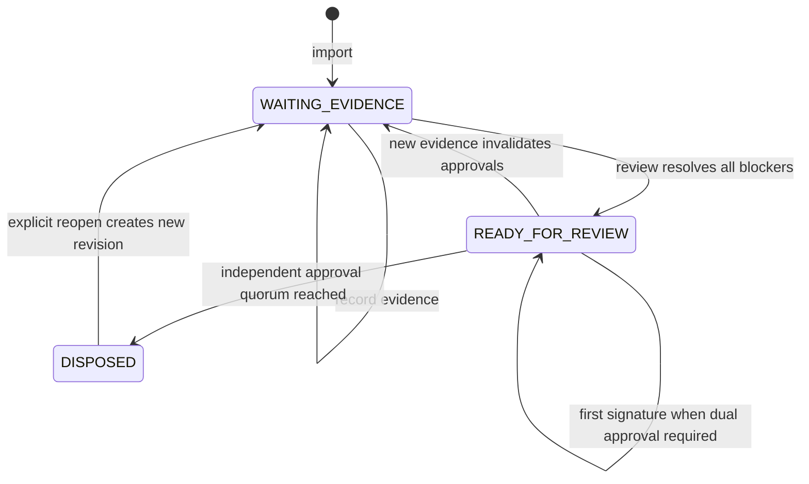

# Implemented case lifecycle

These are the actual persisted prototype states. Approval quorum is policy-dependent; adding evidence invalidates review and pending signatures. Regulatory obligations remain independent throughout. The richer proposed production states are described in [case lifecycle](../docs/04-case-lifecycle.md).

Reopening preserves the previous signed revision. A successful reminder or recorded filing receipt does not change these case states or reset the original alert clock.
