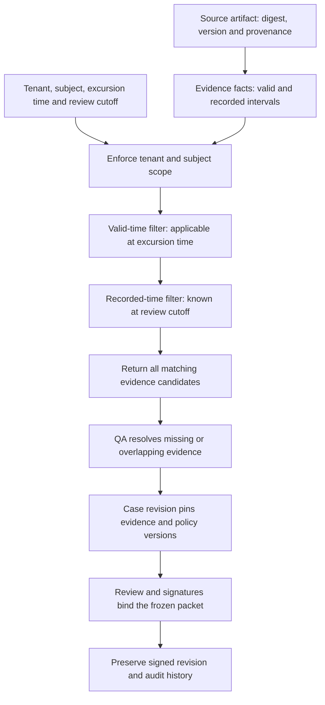

# Data model and time semantics

## Production entities and tenant keys

All operational primary/foreign keys begin with `tenant_id`; database row security is defense in depth, not the only authorization check. Use PostgreSQL for the regional production ledger. Large original bytes live in tenant-keyed immutable object storage; `artifact` stores digest, media type, source version, ownership, received time, malware-scan status and retention policy. Store sensitive content outside ordinary application logs.

| Entity | Important fields and constraints |
|---|---|
| `source_event` / `inbox` | Envelope above; original object hash; immutable revisions; dedupe constraint and processing status. |
| `case` | ID, source event(s), active revision, optimistic version, operational state, assigned queue; no global unscoped identifier lookup. |
| `case_revision` | Reason/opened time; immutable signed snapshot once disposed; inherited references are candidates until revalidated. |
| `evidence_fact` | Subject, fact type, structured value/unit, source artifact/page/region, valid-from/to, recorded-from/to, extractor version, QA verification and uncertainty. |
| `policy_bundle` | Tenant/site/product/jurisdiction scope, version, effective dates, approval roster, clock/calendar rule, source document IDs, signed release manifest. |
| `review` / `signature` | Exact packet digest, actor/authority version, role, intent, timestamp, authentication ceremony result; multiple signatures must bind the same packet and disposition. |
| `batch_exposure` | Batch/presentation/affected quantity, temperature interval and duration, source IDs, uncertainty bounds, correction link; no summing an overlapping duplicate twice. |
| `obligation` | Case/event, jurisdiction/program, policy version, start basis/time, due time, status, responsible person; independent from case state. |
| `notification_attempt` / `receipt` | Obligation ID, stable delivery key, attempt state/time, recipient/channel, payload hash, remote ID/acknowledgement, verification authority. |
| `audit_event` | Tenant/case revision, actor, action, old/new packet references, previous hash, current hash, external checkpoint. |
| `outbox` / `job` | Stable effect key, next attempt, retry count, lease/timeout, error category, durable result; transactional enqueue. |

### Evidence selection across two time axes



**Proposed production model.** Valid time answers “when did this apply?”; recorded time answers “when did the system know it?”. Neither a later correction nor a reopened case overwrites the earlier signed revision. The local snapshot limitation is described below.

Bitemporal records use half-open intervals. Example: select the SOP applicable **at excursion time**, as known **at review time**:

```sql
SELECT * FROM evidence_fact
WHERE tenant_id = :tenant AND subject_id = :site_product
  AND fact_type = 'SOP_APPLICABILITY'
  AND valid_from <= :excursion_time
  AND (valid_to IS NULL OR :excursion_time < valid_to)
  AND recorded_from <= :review_cutoff
  AND (recorded_to IS NULL OR :review_cutoff < recorded_to);
```

Return every candidate; overlapping valid records are a QA exception, not “latest wins”. Confirm end-date semantics with document control before converting inclusive dates. The local prototype's `known_at` filter only expresses the workbook's snapshot date; it is not this full model. Store named timezone/calendar versions and UTC instants for legal clocks; reviewer local offsets must not be inferred from the two known-wrong facility timezone fields.

### Worked example: the inspector's "as at" request

The brief's March incident is the test case for this model. An inspector asked, for a disposition dated 14 August 2025, for the SOP revision in force at the origin site on that date, the stability data relied upon, the temperature series used, and the approver. Only the outcome and approver could be produced.

| Question | Query shape | What answers it |
|---|---|---|
| Which SOP revision applied at the origin site on 14 Aug 2025? | `valid_from <= excursion_time < valid_to` on `SOP_APPLICABILITY` facts for that tenant and site | `evidence_fact` valid-time interval, scoped by tenant/subject |
| Which revision did the reviewer actually see when signing? | Add `recorded_from <= review_cutoff < recorded_to` | `evidence_fact` recorded-time interval; later corrections do not rewrite it |
| What exactly did the signature cover? | Load the `case_revision` pinned by the signature | Signed packet digest binds SOP, study, telemetry artifact digests and policy version |
| Which code, policy and (if any) model version produced the packet? | Read `policy_bundle` and release manifest references on the revision | Versions are pinned per revision, answering the customer's "which version, and tell me when it changes" |

The prototype answers the first and third questions within one snapshot (SOP effective dates, pinned packets, hash-chained export); the second and fourth require the proposed bitemporal and release-manifest records.

Notification uses **alert/detection time** as specified by the pack, not excursion start or disposition time. Production computes fixed-hour, calendar-day, or next-business-day deadlines from an approved program policy and versioned holiday/timezone calendar. Reportability unknown creates urgent manual policy work and conservative escalation, never “not required”. Reopening cannot restart an existing obligation; a genuinely new reportable event creates a separately linked obligation only after policy review.

Batch exposure cannot be computed faithfully from this workbook: batch/quantity identities and full samples are missing. Production records interval unions per exposure domain, concurrent shipment splits and uncertainty rather than blindly summing alert durations. Reserve/update exposure under a batch-level transaction/version when signing; conflicting simultaneous reviews retry with current exposure. A calibration correction references prior samples, triggers dependency lookup, flags affected cases and opens new revisions; it does not apply a uniform +1.8°C correction or delete earlier evidence.

## Implemented snapshot semantics

An import is a workbook snapshot. Its digest makes an identical re-import replayable; a different snapshot is rejected when one is already stored, rather than silently replacing it. The import records an observation timestamp in `tables['_observed_at']`. SOP lookup can accept `known_at`: when that requested knowledge time predates the imported snapshot's observation time, the snapshot cannot support that lookup. Effective-date selection and this observation-time check are distinct. The product index is a historical snapshot and does not provide bitemporal product validity.
