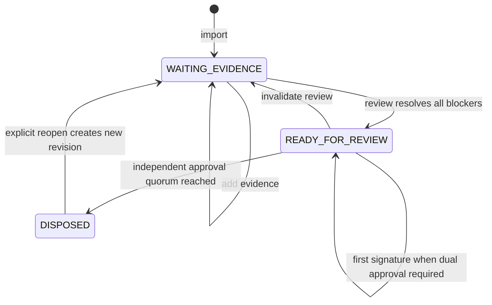

# Case lifecycle and waiting

## Workflow, waiting and delayed corrections

Operational states: `RECEIVED → TRIAGE → WAITING_IDENTITY / WAITING_EVIDENCE / WAITING_EXTERNAL → READY_FOR_REVIEW → AWAITING_SIGNATURE → DISPOSED`. Manual quarantine/rework/return outcomes are dispositions with follow-up tasks, not permission to drop notification monitoring. Approved deterministic duplicate/non-event closure is a separate `CLOSED_NON_ACTIONABLE` route and is **not implemented in the prototype**; every closure requires a qualified rule version, proof and an audited false-closure evaluation.

Each waiting task has owner, reason, required source, evidence freshness condition, next check and escalation deadline. Proposed default: reassess pending obligations every minute and page at 50%, 75%, and 90% of the legal window, plus overdue; QA may require earlier thresholds. These reminders are separate from regulatory filing. Timer jobs survive restart. Dependency callbacks are deduplicated, re-evaluate only affected cases and never clear blockers solely because a connector returned HTTP 200. Manual completion needs source references and authority.

Review captures every blocker resolution and a structured argument: applicable rule, observed fact, evidence citation, uncertainty, disposition and rationale. New evidence/policy changes invalidate pending approvals. Signatures bind the frozen packet hash. A stale case/batch version returns conflict; there is no last-writer-wins release.

Months later, a bulletin or new source creates an impact-review event through the artifact/product/logger dependency index. Retain original decision, original policy and “known then” facts; open a new revision and re-check current authority and evidence. Notify QA and affected claims/invoices through outbox commands with compensating business actions (e.g. withdraw an invoice), not database reversal. Keep exports of both revisions. Claims deadlines and regulatory follow-up obligations require legal review and independent tracking.

## Implemented case state flow

**Implemented locally.** Recording evidence invalidates review and pending signatures. Reopening starts a new revision while retaining the prior signed revision; it never resets an existing regulatory obligation.

[Standalone lifecycle diagram](../diagrams/02-case-lifecycle.md). This embedded diagram mirrors the standalone version; update both when changing the state flow.

Evidence analysis begins with candidates and blockers, not a decision. A reviewer records evidence and resolves every blocker before review; the review also requires references across SOP, stability, telemetry, identity, batch, and contract categories. Signing requires an allowed disposition and an independent signer; the reviewer cannot sign their own packet. A signed case must be explicitly reopened before evidence changes. Every mutation uses an expected integer case version and an idempotency key: stale versions and conflicting key reuse are rejected, while an identical retry can return its prior result.

The optional dual-approval rule is currently a local heuristic: service code searches the tenant's `who_signs_a_disposition` text for the word `dual` using a case-insensitive regular expression. When matched, both `site_qa` and `corporate_qa` signatures are required. This text match is not a policy engine and is not suitable as a production authorization control.

The additional production waiting states described above carry an owner, required evidence, next check and escalation deadline. They are a proposed extension, not additional persisted prototype states.
