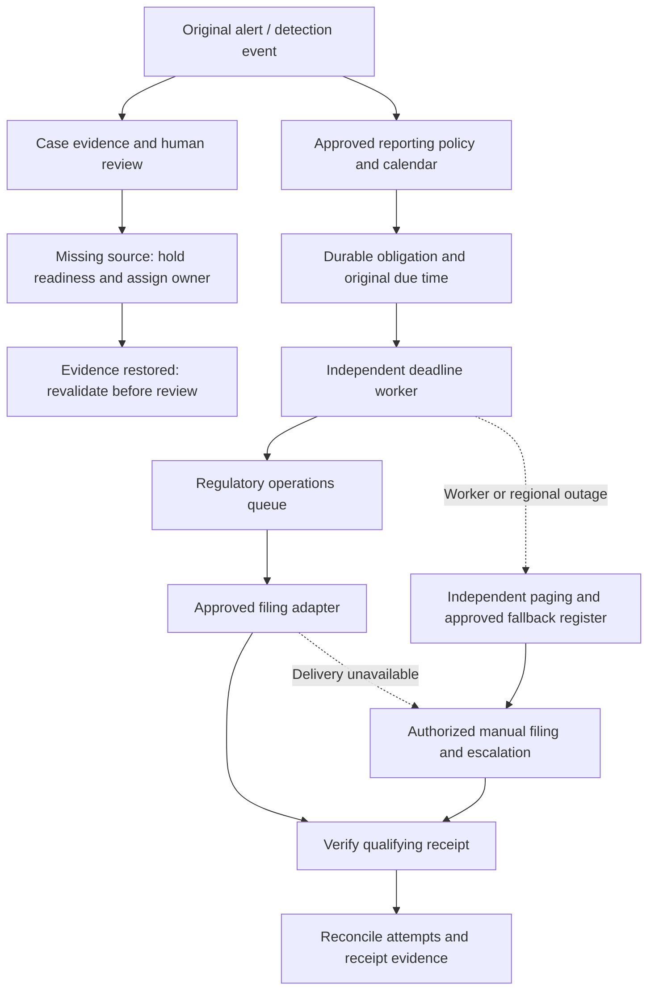

# Degradation and regulatory clock

## Independent clock and failure paths

**Proposed production behavior.** Evidence waiting, retries and reopening do not pause or restart the legal clock. A worker outage requires independent detection and authorized fallback, not an assumed clock suspension. Reconcile fallback records after recovery. The prototype implements internal reminders and human-attested receipts only; it does not implement filing, receipt verification or regional failover.

## Reporting windows stated in the brief

| Jurisdiction or programme (brief §4) | Window | Start basis | Calendar rule needed |
|---|---|---|---|
| Two markets | 72 hours | Alert/detection time | Fixed hours; timezone of the obligation, not the reviewer |
| Brazil | 5 days | Alert/detection time | Calendar days; confirm whether local holidays extend the window |
| One US state programme | Next business day | Alert/detection time | Versioned business-day calendar for that state |
| Any tenant/jurisdiction without an approved policy | Unknown | — | Urgent manual policy work and conservative escalation; never "not required" |

Fourteen filings were late in two quarters, each queued behind a non-actionable alert. The design response is that the obligation is created from the alert and runs on its own worker and priority; queue health, evidence waiting, reopening and disposition do not touch it.

**Worked example (72-hour market).** Alert at 2026-02-10 14:20 UTC. Obligation due 2026-02-13 14:20 UTC regardless of when triage happens. Reminder pages at 50% (2026-02-12 02:20), 75% (2026-02-12 20:20) and 90% (2026-02-13 07:08) of the window, then on overdue. If the case is still `WAITING_EVIDENCE` at 90%, regulatory operations file on the facts available and the case continues; a later reopen in June creates a new revision but does not create a second 72-hour clock. The prototype implements the obligation row, deadline and reminder outbox; the paging thresholds, calendars and filing adapter are proposed.

## Failure modes and regulatory consequences

| Failure | Behavior and recovery | Clock effect |
|---|---|---|
| Source/document/OCR unavailable | Keep last artifact with freshness warning; block unsupported readiness; circuit-break adapter; retry with jitter and per-source quota; controlled manual upload. | None: obligations and human filing route continue. |
| Model/provider unavailable or unqualified replacement | Omit optional narrative/retrieval augmentation; present structured evidence; never silently switch to an unqualified provider. | None; no model dependency in deadline path. |
| Telemetry late, duplicate, permanently missing | Preserve actual series and lineage; dedupe source identity; late evidence triggers reevaluation; gaps remain explicit. | Detection clock is not retroactively shifted by reordering. |
| Queue/worker outage or alert storm | Durable inbox/outbox; reserved regulatory workers; per-tenant fairness, incident grouping, backpressure; backlog-age and deadline-priority monitoring; replay after recovery. | Deadline still elapses; on-call uses manual registry/filing if capacity is at risk. |
| Relational store unavailable | Reject mutations, do not acknowledge commits or issue unlogged signatures; durable source retention; audited manual emergency procedure and later reconciliation. | External duty continues. Secondary monitoring and regulatory owners cannot depend solely on the failed database. |
| Filing transport failure/timeout | Record attempt; retry same stable key; query remote status when outcome is unknown; require receiver dedupe or human reconciliation before resend. A request accepted by an API is not necessarily a legal receipt. | Clock continues until qualifying receipt; page humans early. |
| Region unavailable | Fail over only to an approved same-residency recovery site; otherwise stop data movement and invoke regional manual continuity. | No automatic waiver or clock pause; notify compliance leadership. |
| Audit object corrupt/missing | Fail export verification, page integrity incident, restore verified backup; do not fabricate historical records. | Independent filing duties remain; document control assesses audit impact. |

Proposed targets to agree with operations: audit bundle retrieval within one hour; durable committed case records RPO 0 within the regional replication design, and tested region-recovery RPO/RTO (e.g. ≤15 minutes/≤60 minutes) only if budget and legal policy support it. These are targets, not benchmarked guarantees. Seven years of retained evidence is mandatory; QA/legal must define start event, legal holds, deletion and key-retention policy. Archive original bytes, parsed facts, rendered signed packet, policy/code/model versions and qualified signature evidence. Test restoration and export regularly; hashes alone are insufficient.

## Local prototype limit

The local reminder/outbox is an internal stub only. It neither pauses nor satisfies a legal clock and does not file or confirm delivery. A human-entered receipt is an attestation, not a verified external receipt. Production must separately qualify deadline continuity, escalation, manual filing, and reconciliation.

## Notification and audit boundaries

The notification obligation is created from the original alert data independently of later case review or signature. Its deadline is derived from the alert time and configured reporting window. A recorded receipt is a separate human attestation; it is not created by reminder processing and is not independently verified. The `tick` command processes an internal reminder/outbox stub only. It does not send a regulatory filing or establish that an external recipient received anything.

Audit records are hash-chained and can be exported and checked for chain consistency. This is tamper-evidence within the local application, not WORM storage, a qualified electronic signature, or proof that recorded facts are true.
