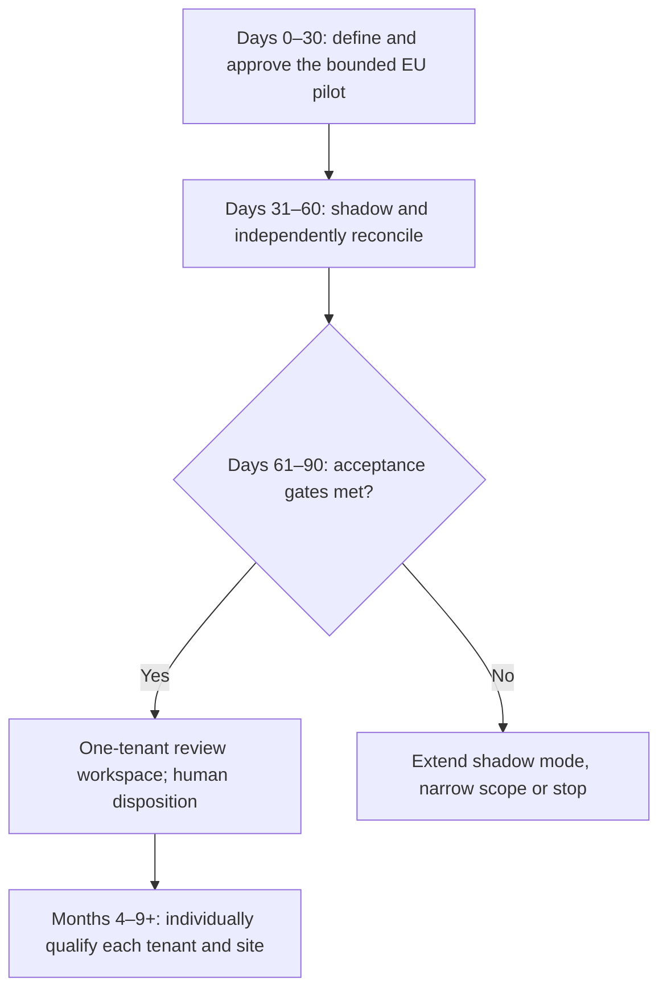

# Future roadmap and rollout

## Gated rollout overview

**Proposed rollout, not a delivery guarantee.** The first customer's anonymized selection and source traceability are in [where we land](01-where-we-land.md). Day 90 is a go/no-go decision; it does not override unresolved safety, residency or source-readiness gates.

## Delivery and decision gates

- **Days 0–30 — define and prepare:** confirm the EU pilot boundary, approved source inventory and ownership, residency and access controls, SOP/study interpretation, signatories, notification policy and timezones, baseline denominators, retention/restore needs, and stop rules. Do not load live records until approval is documented.
- **Days 31–60 — shadow and reconcile:** compare synthetic or explicitly authorized pilot packets against independent human reconstructions. Measure source completeness, temporal selection, tenant isolation, audit export, missing-source handling, backlog, and clock calculations. Keep the tool advisory and non-dispositive.
- **Days 61–90 — go/no-go:** allow review-workspace use only after QA, security, data-governance, and operational acceptance of the prior gates. Otherwise extend shadow mode, narrow scope, or stop. Human disposition authority remains explicit.
- **Months 4–9 and beyond — conditional expansion:** evaluate each tenant and site independently for residency, data-use restrictions, provenance, tags, freshness, policy, signatories, recovery, and support. Do not infer that the first pilot authorizes a multi-tenant deployment.

## Expansion waves and the nine-month target

The board asks for all 34 customers within nine months. The brief's customer mix is 18 Indian, 9 European, 5 American and 2 Brazilian, with eight customers' contractual constraints in `12_Tenant_Constraints`. The plan below reaches 34 only if every gate holds; it is a sequence, not a commitment.

| Wave | Tenants | Prerequisite that gates the wave | Why this order |
|---|---|---|---|
| 0 (days 0–90) | 1 EU pilot tenant | Shadow reconciliation accepted by QA, security, governance and operations | Smallest boundary with the strongest auditability demand |
| 1 (months 4–5) | Remaining 8 European tenants | Same regional cell, same residency controls; per-tenant signatory and SOP ownership confirmed | Reuses the qualified EU cell without new residency work |
| 2 (months 5–7) | 18 Indian tenants | India cell qualified; tenants with explicit non-sharing clauses onboarded with isolation tests | Largest population; proves per-tenant isolation at scale |
| 3 (months 7–9) | 5 American and 2 Brazilian tenants | Next-business-day and five-day calendars approved; US/Brazil cells or an approved residency position | Hardest clock semantics last, after the clock worker has run in production |
| Hold | Any tenant with unresolved data-use, residency or connector readiness | Not onboarded until resolved | "One customer and be certain" applies to each wave |

If wave 3 is not ready by month nine, the correct outcome is to report the slip with the gate that failed, not to onboard under an unapproved clock policy.

This phased plan is contingent on implementation and qualification of the proposal in [versioning and deployment](06-versioning-and-deployment.md), and the open questions in [risks](09-risks-assumptions-and-open-questions.md).
