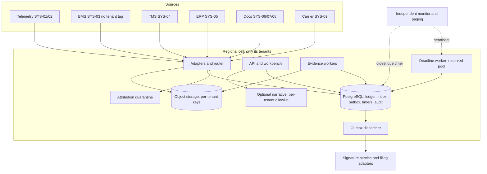
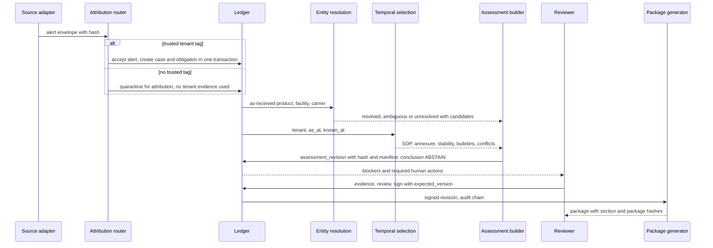
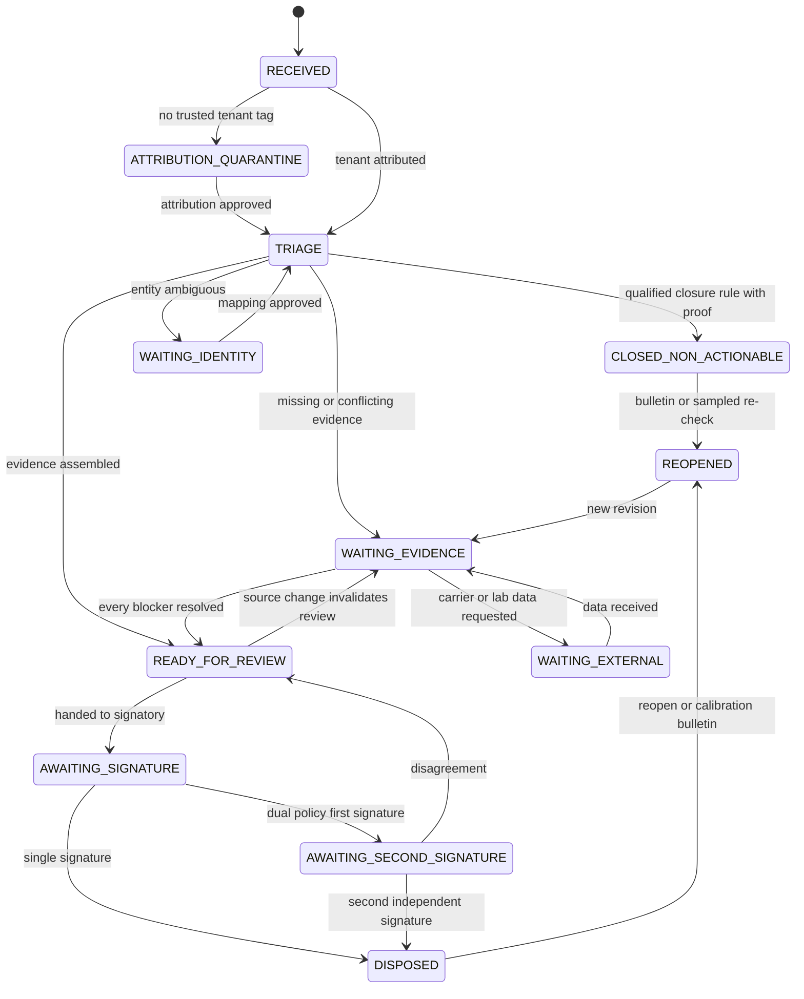
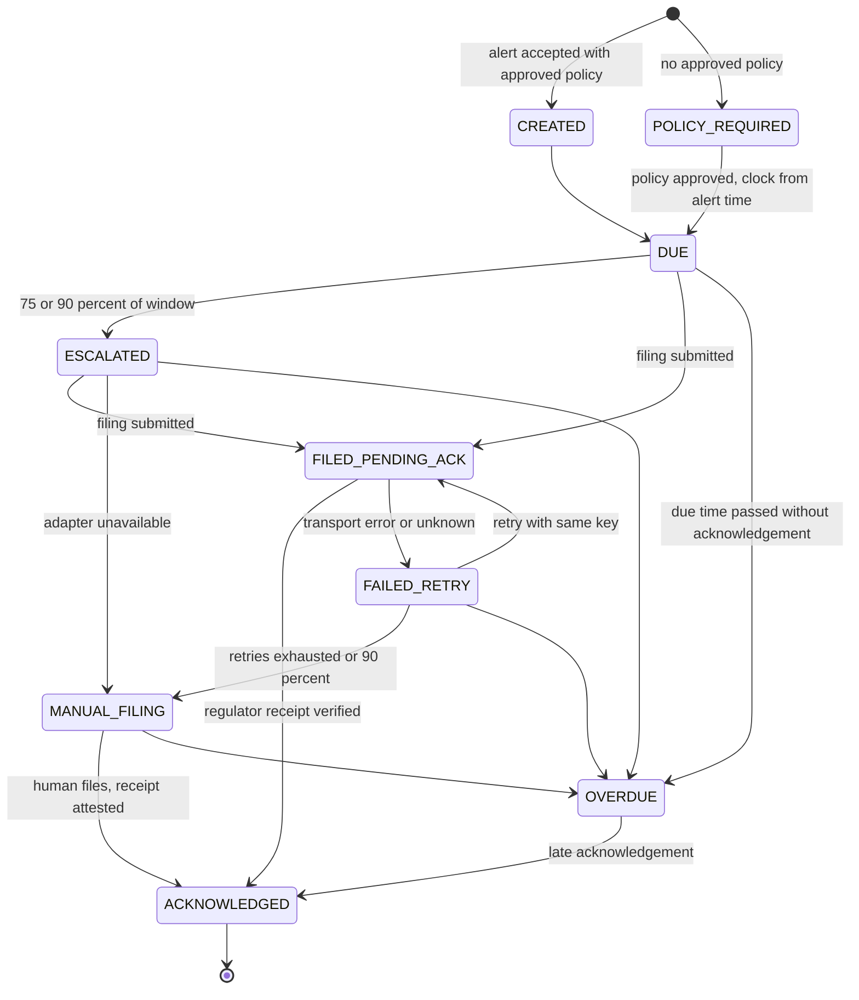
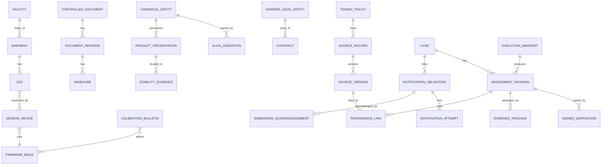

# Detailed design (low-level design)

Scope: the buildable specification behind the HLD in [02](02-system-architecture.md), [03](03-data-model.md), [04](04-case-lifecycle.md), [05](05-degradation-and-regulatory-clock.md) and [06](06-versioning-and-deployment.md). The HTTP routes that exist today are in [API.md](API.md); this document does not change them.

**Labels used in every section**

| Label | Meaning |
|---|---|
| **Implemented** | Exists in `prototype/` (version 0.2.0) and is exercised by its CLI/tests. File names are given. |
| **Proposed** | Production design. Not built, not qualified. Values (timeouts, RPO/RTO, quotas) are engineering defaults for QA/legal/operations to approve. |
| **Unavailable evidence** | Something the design needs that the reference pack or brief does not contain. The design degrades to a named blocker, never to a guess. |

Privacy: this document uses tenant codes and record IDs only. No reviewer, customer-contact or signatory names, and no free text from the pack, are reproduced.

Sizing arithmetic (from the brief): 128,000 consignments/month; ~10 M readings/day (~116/s average); 11,400 alerts/month (~380/day, ~8 real cases/hour at 18 % actionable); 34 tenants. One INC-2502-style burst is 1,912 alerts in 38 minutes (~50/min). These are modest transactional volumes; the hard parts are correctness, time semantics, isolation and deadline reliability, not throughput.

---

## 0. Architecture decision: modular monolith plus workers

**Decision (Proposed).** One Python code base, deployed per regional cell as: an API/workbench process, an **ingestion worker** pool, an **evidence worker** pool, a **deadline worker** (reserved, separate connection pool and database role), and an outbox dispatcher. Each cell has one PostgreSQL primary (+ synchronous in-region standby), one object-storage bucket-set with per-tenant prefixes and keys, and an `outbox` and a `timer` table in the same database. The prototype already has this shape in miniature: one `Engine` (`workflow/service.py`) behind two adapters (CLI, loopback HTTP), a transactional audit chain, and an outbox row.

**Why this is enough for a six-engineer team and the pilot**

| Concern | Answer |
|---|---|
| One transaction must cover case version, signature, audit event and outbox intent | A single relational database gives this for free; splitting services would need sagas for the most regulated write in the system. |
| Throughput | ~380 alerts/day and ~116 readings/s are well inside one PostgreSQL primary if raw readings stay in object storage (Parquet) and Postgres holds aggregates, windows and pointers. |
| Fault isolation that matters | The one real boundary is **deadline work vs everything else** (14 filings were late behind non-actionable alerts). A separate process, pool and DB role gives this without a service mesh. |
| Isolation that matters | Tenant isolation is enforced by key prefix `tenant_id` on every operational table, per-tenant object keys, per-tenant queues and cache namespaces, and regional cells. None needs a separate service. |
| Team size | Six engineers cannot operate N services, N pipelines, N on-call surfaces and the qualification evidence for each. Every deployable unit multiplies the change-control burden (see §8). |

**Not required for the pilot, and why**

| Technology | Why it is not required | Revisit when |
|---|---|---|
| Microservices | No independent scaling or trust boundary beyond the deadline worker and the (already separate) signature/filing authorities. | A component needs a different release cadence *and* a different qualification owner. |
| Graph database | Provenance is a bounded typed-edge table (`provenance_link`) queried by recursive CTE to depth ≤ 6 (logger → readings → assessments → cases). The dependency lookup is "logger → cases", a join. | Cross-tenant-free graph analytics beyond ~10⁷ edges per cell. |
| Vector database / embeddings | Pilot precedent retrieval is **structured and tenant-scoped** (same tenant, same product presentation, same SOP/annexure, same lane, same excursion class) in SQL. Embeddings are only an optional ranking aid over an already-authorised candidate set (§1.10), and would be per-tenant. | Structured retrieval demonstrably misses relevant precedents in the retrospective benchmark. |
| Autonomous agents | The task is evidence assembly with a human-signed decision. Agents add non-determinism to the path that must be reproducible; the earlier end-to-end pilot fabricated evidence. | Never in the decision path (see §1.10). |
| Kubernetes | Two or three process types per cell; managed VMs or a container service with a restart policy suffice. In-cell autoscaling is not needed at these volumes. | A cell needs elastic multi-node worker pools, or the operator's platform standardises on it. |
| Kafka/streaming platform | Postgres `inbox`/`outbox`/`timer` tables with `FOR UPDATE SKIP LOCKED` give at-least-once delivery at <1 k events/min. SYS-03's upstream Kafka is a *source*, consumed by an adapter. | Sustained ingest above a few thousand events/s per cell. |

---

## 1. Component boundaries

Common rules: every call carries a `tenant_id` and a `principal`; no component reads another's tables except through its published function or view; a component that cannot reach its dependency **fails closed** (no guess, no silent default) and surfaces a blocker or a queued retry.

### 1.1 Source ingestion and immutable source versions
| | |
|---|---|
| **Status** | Implemented (snapshot only: `ingestion/workbook.py`, `Engine.ingest`). Proposed (continuous adapters). |
| **Why** | Audit needs the exact bytes a conclusion was built from; one input system's retry or correction must never overwrite what a signed case saw. |
| **Inputs** | Adapter payloads per the HLD canonical envelope (`tenant_id, source_system, source_event_id, source_revision, event_time_utc, observed_at_utc, ingested_at_utc, schema_version, source_uri, source_sha256, correlation_id, payload`). Prototype: an XLSX file; SHA-256 of the file; rows keep `_row`. |
| **Outputs** | `source_record` (stable identity) + `source_version` (immutable: hash, received_at, recorded_at, object URI); an `inbox` row; a normalised event. Prototype: `imports(hash, observed_at, tables_json)`, `cases`, `obligations`, `outbox`, audit `IMPORTED`. |
| **Crosses the boundary** | Hash + object URI + envelope; never the raw bytes into logs. |
| **Rules** | Unique `(tenant_id, source_system, source_event_id, source_revision)`; same key with a different hash → quarantine, not overwrite (prototype: "Changed source event requires explicit reconciliation, not overwrite", 409). Persist bytes before acknowledging. Never infer that two excursions are the same event from equal temperature/duration. |
| **When unavailable** | Source down: last good `source_version` remains, flagged stale; adapter circuit-breaks with jitter; manual controlled upload creates a `source_version` with an `uploaded_by`/authority. Ingestion worker down: events accumulate in the source or inbox; **obligation creation happens in the same transaction as the alert's acceptance** so a downstream outage cannot delay it (§1.7). |
| **Unavailable evidence** | SYS-02 duplicate message IDs after reboot and 90-minute reordering are documented but there is no sample; dedupe is by `source_event_id` only, with a quarantine for same-ID/different-content. |

### 1.2 Tenant attribution and regional routing
| | |
|---|---|
| **Status** | Implemented as a *flag*: telemetry from `UNTAGGED_SOURCE_SYSTEMS = ("SYS-03",)` raises the conflict "Tenant attribution is inferred, not recorded at source… quarantine for attribution" (`evidence/assessment.py`). Tenant-owner check: `assess` returns the same `AccessDenied` for foreign and missing events. Proposed: the router and quarantine store. |
| **Why** | A misrouted record is a cross-tenant disclosure and, in EU/India, a residency breach. The brief's near-miss was a retrieval leak. |
| **Inputs** | Envelope with `tenant_tag` (trusted only if the source system signs/binds it: SYS-01, 02, 04, 05 carry tenant context; **SYS-03 BMS carries none**). |
| **Outputs** | `{tenant_id, cell}` or `ATTRIBUTION_QUARANTINE`. |
| **Rules** | Trusted-tag → route by `tenant_policy.cell`. No trusted tag → write to a **restricted quarantine** in a cell-neutral, evidence-free holding area (hash + source ID + facility/room codes only; no payload visible to tenant users) and open a task for a named attribution reviewer. Attribution is an approved assertion (`attribution_assertion`: record, tenant, basis = TMS room-to-consignment mapping version, approver, recorded_at). **Never guess from facility or product name.** A quarantined SYS-03 record contributes nothing to any assessment until attributed; the assessment lists it as `missing_inputs`. |
| **Crosses** | Only `tenant_id`, `cell` and record hash leave the router. |
| **When unavailable** | Router down → ingestion halts for untagged sources only; tagged sources route using a cached, signed `tenant_policy` snapshot. Deny on doubt. |
| **Unavailable evidence** | The pack contains no room-to-consignment mapping (it is in TMS): attribution cannot be computed from the pack. T-VIRENT alone has 4 of 9 sites sending BMS data without tags. |

### 1.3 Entity resolution and human-approved mappings
| | |
|---|---|
| **Status** | Implemented (read-only, exact, tenant-scoped; `_resolve_product`, `_resolve_facility`, `_resolve_carrier`). Proposed (governed `alias_assertion` lifecycle). |
| **Why** | Product, facility and carrier identity is the largest manual cost; mappings in the pack are partly informal or wrong. |
| **Inputs** | As-received strings (`product_ref_as_received`, `origin_ref_as_received`, `carrier_ref_as_received`), tenant, `known_at`. |
| **Outputs** | Entity record with `status` ∈ `RESOLVED_EXACT_TENANT_SCOPED`, `AMBIGUOUS`, `UNRESOLVED`, `MISSING_REFERENCE`, the candidate list, `unverified_alias_candidates`, and `source_refs`. |
| **Rules** | **Alias observation = candidate. Alias assertion = approved mapping with a recorded time.** Observations (207 rows in `07_Alias_Observations`, no status column) can propose but never resolve; only an `approved` assertion by a user other than the proposer resolves. Zero or many candidates → `WAITING_IDENTITY`. Product identifiers are only unique within a tenant (the pack shares e.g. an internal SKU across 2–4 tenants), so every lookup carries `tenant_id`. Carrier parent vs subsidiary: contracts are matched by legal entity and effective window; a name matching more than one legal entity is a conflict. Facility timezone uses an **approved** timezone only; the registry's two conflicting values are a conflict, not a vote. |
| **Crosses** | Candidate IDs, never merged identities across tenants. |
| **When unavailable** | Resolution failure → case stays `WAITING_IDENTITY`; the obligation is unaffected. |
| **Unavailable evidence** | Alias observations carry only `confirmed_on`/`confirmed_by`; no approval workflow, no valid interval, no rejection record. Prototype therefore shows them as unverified candidates. |

### 1.4 Controlled evidence and document registry
| | |
|---|---|
| **Status** | Implemented as indexes only (SOP, stability index rows); Proposed registry. |
| **Why** | The inspection failure was missing historical SOP/stability/temperature evidence. An index row is not a document. |
| **Inputs** | SYS-06 controlled export with manifest and QA ownership attestation (no API); SYS-07 REST (exact revision + annexes, 60 req/min); SYS-08 controlled export. |
| **Outputs** | `controlled_document` → `document_revision` → `annexure`, `stability_evidence`, each with original + rendition hashes and an extraction record (OCR is a proposal until a human verifies it). |
| **Rules** | Tenant ownership comes from an attested owner field, **not** the storage path (the prototype uses the `tenant_code` column; the pack's path column does not name the owner). Handwritten changes to acceptance limits (T-KAVERI: 2 scanned annexures) are stored as an `annexure` whose limits are a **human-transcribed, second-verified** value linked to the scan; OCR alone is never evidence. A stability study with no permitted-excursion statement, unreadable scan, or wrong presentation is stored as such and surfaces as a blocker. |
| **When unavailable** | Library or repository down: serve the last registered revision with a freshness warning; block `READY_FOR_REVIEW` if the needed revision was never registered; manual upload path with authority recorded. |
| **Unavailable evidence** | Full SOP/stability documents are not in the pack; the stability index covers ~60 % of the repository; SOP supersession is free text; the pack has 203 SOP rows with date-only `effective_from`, 64 open-ended, 114 site-specific. |

### 1.5 Temporal policy selection
| | |
|---|---|
| **Status** | Implemented as `sops_as_at` + `_sop_evidence` + `assess(known_at, corrections)`; Proposed with `annexure` and approved timezone. |
| **Why** | The right SOP is the one in force at the origin site at excursion time, as known on the review date — and the answer must be reproducible. |
| **Inputs** | Tenant, subject (site, product presentation), `as_at` (excursion start), `known_at`. |
| **Outputs** | All candidate revisions with flags, `rejected` with reasons, and `conflicts`; never a single "latest". |
| **Rules** | See §3. Overlap is stored as a conflict for document control. |
| **When unavailable** | If documents are not registered → `missing_inputs`; if timezone is not approved → boundary-day candidates flagged; never defaulted. |

### 1.6 Alert triage (non-actionable closure; separate from disposition)
| | |
|---|---|
| **Status** | Not implemented. The prototype has no deterministic closure (HLD says so). Proposed. |
| **Why** | The board target is ≥ 70 % closed without review. A closure is not a disposition: it asserts "no actionable excursion", and the brief permits automation for closures but not decisions. |
| **Inputs** | Normalised alert, current approved closure rule set, `known_at`. |
| **Outputs** | `CLOSED_NON_ACTIONABLE` with `{rule_id, rule_version, evidence_refs, proof}`, or route to case workflow. |
| **Rules** | A closure rule must carry a qualified version, a machine-checkable proof (e.g. duplicate of an existing event by `source_event_id` + same logger window; excursion inside the product's approved permitted window using verified stability/SOP facts), and an audited false-closure rate. Closures are sampled for human re-check (proposed: a fixed-rate random sample plus all closures near a threshold). **A closure never suppresses a notification obligation** — obligations are created before triage. A closed alert can be re-opened if a calibration bulletin affects its logger (§5.4). |
| **When unavailable** | Triage down → alerts route to the case queue (fail open to human work), not to closure. |
| **Unavailable evidence** | Historic closure outcomes of the existing 2,400-rule engine are not in the pack; false-closure rate cannot be estimated from it. The prototype's `01_Excursion_Events` outcome columns are excluded from assessment inputs by design. |

### 1.7 Case workflow and reviewer actions
| | |
|---|---|
| **Status** | Implemented (`Engine.command`: `evidence`, `review`, `sign`, `reopen`, `notify`; version, idempotency, role checks, hash-chained audit). Proposed: waiting states, triage, AWAITING_SECOND_SIGNATURE, a policy roster. |
| **Why** | A human-signed decision bound to an exact evidence packet. |
| **Inputs** | Commands with `expected_version`, `Idempotency-Key`, principal. |
| **Outputs** | New `case.version`, revision packet, audit event, outbox intents. |
| **Rules** | One transaction per command. Reviewer ≠ signer. Adding evidence invalidates review and signatures. Dual approval requires distinct actors and roles with identical dispositions (prototype detects dual via the whole word `dual` in the tenant's signing text — a local heuristic, replaced by a roster in production). Stale version → 409. |
| **When unavailable** | Database down → reject mutations, issue no unlogged signature; manual procedure with later reconciliation (§6). |

### 1.8 Independent notification obligations and deadline scheduling
| | |
|---|---|
| **Status** | Implemented (obligation row from `alert_ts_utc`, `outbox` reminder, `tick`, human-attested `notify`, derived status). Proposed: policy/calendar service, durable timer, filing adapters, acknowledgement. |
| **Why** | 14 filings were late, each queued behind a non-actionable alert. The legal clock is independent of case state. |
| **Inputs** | The accepted alert (time, tenant, jurisdiction/programme) and an approved reporting policy version. |
| **Outputs** | `notification_obligation`, `timer` rows (reminders at 50/75/90 % and at due), `notification_attempt`, `submission_acknowledgement`. |
| **Rules** | Created **in the ingestion transaction**, keyed `(tenant, event, jurisdiction, programme)`; never merged for storms. Starts at alert/detection time. Waiting, reopening, retries and disposition never pause or reset it. Missing approved policy → state `POLICY_REQUIRED`, urgent human work, conservative escalation — never "not required". Transport success ≠ regulator receipt. |
| **When unavailable** | Worker down: independent heartbeat pages on-call; manual filing register. Filing adapter down: retry then human filing. |
| **Unavailable evidence** | Which two markets use 72 h, the Brazil holiday treatment and the US programme's business calendar are not in the pack; the prototype takes `regulator_reportable`/`reg_window_hours` from the alert row as provisional inputs. |

### 1.9 Tenant-scoped precedent retrieval
| | |
|---|---|
| **Status** | Proposed. Not implemented in the prototype (no retrieval exists). |
| **Why** | Reviewers benefit from "how did we handle this class of excursion for this product and SOP before?", but a similar-case lookup leaked once. |
| **Inputs** | `tenant_id`, structured filters (product presentation, SOP/annexure revision, lane, excursion class), `known_at`. |
| **Outputs** | A list of signed `assessment_revision` IDs from **that tenant only**, each with its hash. |
| **Rules** | Authorisation is applied **before** the query: the retrieval function takes `tenant_id` as a mandatory argument and queries tables whose PK starts with `tenant_id`; there is no unscoped index. Any cache key, embedding index, or search index is per tenant (and per cell) and is built only from that tenant's rows. T-MERIDIAN data is never in a shared structure (§7). Precedent is displayed as context, never as evidence of applicability. |
| **When unavailable** | Retrieval is optional; the assessment proceeds without it. |

### 1.10 Evidence package generation
| | |
|---|---|
| **Status** | Implemented (`package`, `verify_package`; CLI `assess`, `verify-assessment`; `Engine.export`, `verify_export`). Proposed: sealed PDF/JSON bundle, WORM archive. |
| **Why** | "Full basis for any disposition within an hour, for seven years." |
| **Inputs** | `assessment_revision`, `signed_disposition`, source versions, execution manifest. |
| **Outputs** | A bundle with section hashes and a package hash; export contains audit chain, revision packets, source hash. |
| **Rules** | Deterministic: same inputs → byte-identical canonical JSON (`sort_keys`, compact separators) → same SHA-256. Package includes the manifest and the exact artefact hashes, not copies of other tenants' data. |
| **When unavailable** | Archive unreachable → export fails verification and pages an integrity incident; do not reconstruct from memory. |

### 1.11 Optional LLM assistance
| | |
|---|---|
| **Status** | Not implemented. Proposed as optional and **narrative only**. |
| **Why** | A model can draft readable, cited summaries; it cannot be trusted with decisions (pilot fabrication; prompt change shifted 31 tenants). |
| **Inputs** | The assessment's structured evidence and a prompt template version; tenant policy `allowed_model` entry. |
| **Outputs** | A draft narrative with per-sentence citations to evidence IDs, validated against the structured output; stored as an unsigned artefact with its manifest. |
| **Rules** | Never in the decision path: no model output sets readiness, disposition, a deadline, an entity mapping or a closure. Per-tenant allowlist evaluated **before** retrieval and before building the model input: T-VIRENT = prohibited; T-AURA = EU-hosted endpoint only; T-NORDIA = non-batch-identifiable data only; T-MERIDIAN: Cl.22 — no index, fine-tune, cache or derived artefact built on its data may serve another tenant, so only tenant-exclusive, non-shared model calls with no retained derivative; the 6 other tenants that prohibit third-party model APIs are the same as T-VIRENT. Spend is budgeted per tenant against the $3,000/month ceiling before each call. |
| **When unavailable** | The "no-LLM" route is a first-class, qualified mode: reviewers see the structured evidence without a narrative (§8, INC-2509). |

### 1.12 Audit, observability, retention and access control
| | |
|---|---|
| **Status** | Implemented: hash-chained `audit` table (`previous_hash`, `hash` over canonical entry), `verify_export`, role checks, loopback bearer stub; no bearer token or case ID logged. Proposed: SSO, ABAC, WORM archive, retention engine. |
| **Rules** | Append-only audit with periodic external checkpoint of the chain head; retention seven years from a start event QA/legal must define (disposition date vs case close vs product expiry), legal hold flag, key-retention (crypto-shredding only after retention). Metrics and logs carry IDs and counts, never payload. Access = tenant principal + role + site scope; RLS in PostgreSQL as defence in depth only. |
| **When unavailable** | Audit write failure aborts the command (audit is in the same transaction). Log/metrics outage never blocks a decision, but the independent deadline monitor is separate infrastructure. |

---

## 2. Data model

Rules for the whole schema (Proposed unless noted):

- PostgreSQL per regional cell; the cell holds only its tenants' rows. Every operational table's **primary key and foreign keys start with `tenant_id`**; there are no unscoped surrogate lookups. RLS (`USING (tenant_id = current_setting('app.tenant_id')::text)`) is defence in depth.
- Time columns are `timestamptz` (UTC). Valid-time intervals are half-open ranges `[from, to)`; `to IS NULL` = open. Recorded-time columns are `recorded_from`/`recorded_to`, the latter set by supersession, never by `UPDATE` of the content columns.
- Immutable tables (`source_version`, `assessment_revision`, `signed_disposition`, `audit_event`, `document_revision` content) are protected by a `BEFORE UPDATE OR DELETE` trigger that raises, and `REVOKE UPDATE, DELETE` for the application role.
- **Implemented now** (SQLite, `workflow/service.py`): `imports`, `cases`, `revisions`, `audit`, `idempotency`, `obligations`, `outbox`. Everything else is Proposed.

### 2.1 Entity table

| Entity | Key | Key columns and constraints | Indexes | Relationships |
|---|---|---|---|---|
| `tenant_policy` | `(tenant_id)` | `cell`, `residency` (EU/IN/none), `model_policy` enum (`PROHIBITED`/`EU_HOSTED_ONLY`/`NON_BATCH_ONLY`/`ALLOWED`/`EXCLUSIVE_ONLY`), `output_language`, `signature_policy_id`, `policy_version`, `valid` range; `CHECK` cell consistent with residency. | `(cell)` | 1—N everything |
| `source_record` | `(tenant_id, source_system, source_event_id)` | Stable identity of an upstream thing. | — | 1—N `source_version` |
| `source_version` | `(tenant_id, source_record_id, source_revision)` | `content_sha256` (bytea, NOT NULL), `object_uri`, `received_at`, `recorded_at`, `event_time`, `supersedes_revision`; immutable; `UNIQUE(tenant_id, source_record_id, content_sha256)`; same revision + different hash → quarantine row. | `(tenant_id, recorded_at)` | → `provenance_link` |
| `attribution_assertion` | `(tenant_id, record_ref)` | Created from quarantine; `basis_version`, `approved_by`, `approved_at`. | — | → `source_version` |
| `canonical_entity` | `(tenant_id, entity_id)` | `kind` ∈ product, facility, carrier, device…; `canonical_key`; `UNIQUE(tenant_id, kind, canonical_key)`. | `(tenant_id, kind)` | 1—N `alias_assertion` |
| `alias_assertion` | `(tenant_id, assertion_id)` | See DDL §2.2.3. | partial unique on approved | → `canonical_entity` |
| `product_presentation` | `(tenant_id, presentation_id)` | `entity_id`, `brand_as_labelled`, `internal_sku`, `gtin`, `legacy_code`, `presentation` (vial/pen/…); identifiers unique **per tenant only** (the same value appears under several tenants in the pack). | `(tenant_id, gtin)` | → `stability_evidence` |
| `facility` | `(tenant_id, facility_id)` | `kind`; per-source records in `facility_source_record(tenant_id, facility_id, source_system, record_id, timezone_in_source)`; `approved_timezone` (IANA, NULL until approved), `timezone_approved_by/at`; `CHECK` approved_timezone is a valid IANA name. | `(tenant_id, record_id)` | 1—N source records |
| `carrier_legal_entity` | `(tenant_id, legal_entity_id)` | `legal_name`, `parent_legal_entity_id` (same tenant, no cycles), `jurisdiction`. | `(tenant_id, parent)` | 1—N `contract` |
| `contract` | `(tenant_id, contract_id)` | `legal_entity_id`, `effective` range, `claim_window_days`, `liability_cap`, `amendment_of`; overlap of effective ranges for same entity+scope is a stored conflict. | gist on `(tenant_id, legal_entity_id, effective)` | → `case` |
| `shipment` | `(tenant_id, shipment_id)` | `source_record_id`, `mode`, `origin_facility_id`, `dest_facility_id`. | `(tenant_id, shipment_ref)` | 1—N `leg` |
| `leg` | `(tenant_id, shipment_id, leg_no)` | `carrier_legal_entity_id` (nullable: unknown carrier stays null with reason), `planned` / `actual` ranges. | | → `sensor_device` via `leg_device` |
| `batch` | `(tenant_id, batch_id)` | **Only where evidence exists**: `batch_ref`, `presentation_id`, `quantity`, `expiry`; otherwise the case stores `batch_id NULL` + `batch_null_reason` ∈ (`NOT_IN_SOURCE`, `AMBIGUOUS`, `NOT_YET_RECEIVED`). | | |
| `affected_pallet` | `(tenant_id, case_id, pallet_id)` | `batch_id`, `qty`, `exposure` range, `evidence_source_version`. Absent rows = unknown, never zero; `CHECK` exposure ranges not double-counted (union computed, not summed). | | |
| `sensor_device` | `(tenant_id, device_id)` | `vendor`, `serial`, `firmware_build_id`, `source_system`. | `(tenant_id, firmware_build_id)` | → `calibration_bulletin` |
| `firmware_build` | `(vendor, build)` (global reference, no tenant data) | e.g. `TT-2.14.3`. | | |
| `calibration_bulletin` | `(bulletin_id)` global, linked per tenant by `bulletin_applicability(tenant_id, device_id)` | `affected_builds[]`, `bound_text` (e.g. "up to X °C", unparsed original kept), `bound_value` NULL unless QA-approved, `direction` NULL unless known, `recorded_at`. No fixed correction is ever applied from the bulletin. | `gin(affected_builds)` | → `reopen_trigger` |
| `controlled_document` | `(tenant_id, document_id)` | `doc_type` (SOP/STABILITY/CONTRACT), `owner` (tenant-owned vs KCCS-owned), `supersession_text` (kept verbatim; not authoritative). | | 1—N `document_revision` |
| `document_revision` | `(tenant_id, document_id, revision_label)` | See DDL §2.2.2. | | 1—N `annexure` |
| `annexure` | `(tenant_id, document_id, revision_label, annexure_id)` | `site_scope` (facility IDs[] or `ALL`), `effective_from`/`effective_to` (date), `tz_policy`, `limits` (structured), `transcription_verified_by[]` (≥ 2 for handwritten), `scan_sha256`. | gist on `(tenant_id, site_scope, daterange)` | → `document_conflict` |
| `document_conflict` | `(tenant_id, conflict_id)` | `subject` (doc/site), `members[]` (revision labels), `kind` (`OVERLAP`, `GAP`, `BOUNDARY_DAY`), `status` (`OPEN`/`RESOLVED`), `decision` JSON (chosen revision, rationale, `decided_by`, `decided_at`). **Never resolved by highest revision or latest row.** | `(tenant_id, status)` | |
| `stability_evidence` | `(tenant_id, study_id)` | `owner_tenant_id` (must equal `tenant_id`; cross-tenant ref rejected), `presentation_id`, `readability` ∈ (`READABLE`, `PARTIAL`, `UNREADABLE`), `study_type`, `permitted_excursion` JSON or NULL (**NULL = no statement; a study without one cannot support release**), `document_revision` pointer. | `(tenant_id, presentation_id)` | |
| `case` | `(tenant_id, case_id)` | `event_id`, `state`, `version` int (optimistic), `current_revision`, `disposition_policy_id`, `queue`, `assignee`. | `(tenant_id, state)` | 1—N `assessment_revision` |
| `assessment_revision` | `(tenant_id, case_id, revision_no)` | See DDL §2.2.1. | | → `signed_disposition` |
| `signed_disposition` | `(tenant_id, case_id, revision_no, role)` | `disposition`, `packet_sha256`, `signatory_id`, `authority_version`, `signed_at`, `ceremony_ref`; second row for dual policy; `UNIQUE(…, signatory_id)`; `CHECK` signatory ≠ reviewer (trigger). | | |
| `notification_obligation` | `(tenant_id, obligation_id)` | See DDL §2.2.4. | | → attempts, acks |
| `notification_attempt` | `(tenant_id, obligation_id, attempt_no)` | `effect_key`, `channel`, `payload_sha256`, `started_at`, `outcome` (`TRANSPORT_OK`, `TRANSPORT_ERROR`, `UNKNOWN`), `remote_ref`. | `UNIQUE(tenant_id, effect_key, attempt_no)` | |
| `submission_acknowledgement` | `(tenant_id, obligation_id, ack_no)` | `kind` (`REGULATOR_RECEIPT`, `HUMAN_ATTESTED`, `REGULATOR_REJECTION`), `received_at`, `evidence_sha256`, `verified_by`; **only `REGULATOR_RECEIPT` or an authorised human attestation moves an obligation to `ACKNOWLEDGED`**. | | |
| `evidence_package` | `(tenant_id, package_id)` | `case_id`, `revision_no`, `package_sha256`, `object_uri`, `generated_at`, `manifest_id`. | `(tenant_id, case_id)` | |
| `provenance_link` | `(tenant_id, link_id)` | `from_type, from_id, from_version`, `to_type, to_id, to_version`, `link_type` (`DERIVED_FROM`, `CITES`, `SUPERSEDES`, `AFFECTED_BY`, `ATTRIBUTED_BY`), `recorded_at`; `UNIQUE` on the 7-tuple. | `(tenant_id, to_type, to_id)` and from-side | drives dependency lookup |
| `execution_manifest` | `(tenant_id, manifest_id)` | See DDL §2.2.5. | | 1—N `assessment_revision` |
| `inbox`, `outbox`, `timer`, `idempotency`, `audit_event` | `(tenant_id, …)` | Infrastructure tables (§6). `audit_event(tenant_id, seq)` with `previous_hash`, `hash`. | `timer(due_at) WHERE state='PENDING'` | |

**Implemented mapping:** `cases`↔`case`, `revisions`↔`assessment_revision` (without a hash/manifest; the packet JSON is the whole snapshot), `obligations`↔`notification_obligation` (`alert_at`, `deadline`, `receipt_json`), `outbox`↔`outbox` (one row per case; `attempts`, `delivered_at`, `last_error`), `imports`↔`source_version` (one workbook snapshot per database).

### 2.2 Central DDL (Proposed, PostgreSQL)

#### 2.2.1 `assessment_revision`
```sql
CREATE TABLE assessment_revision (
  tenant_id        text        NOT NULL REFERENCES tenant_policy(tenant_id),
  case_id          text        NOT NULL,
  revision_no      int         NOT NULL CHECK (revision_no >= 1),
  supersedes_no    int,
  reason           text        NOT NULL CHECK (reason IN
                     ('INITIAL','NEW_SOURCE_VERSION','NEW_EVIDENCE','CALIBRATION_BULLETIN',
                      'DOCUMENT_CONFLICT_RESOLVED','REOPEN','POLICY_CHANGE')),
  as_at            timestamptz,                 -- valid time of the question (excursion start)
  known_at         timestamptz NOT NULL,        -- knowledge cutoff of the question
  assessment_json  jsonb       NOT NULL,       -- entities, evidence, conflicts, missing_inputs...
  assessment_sha256 bytea      NOT NULL,       -- over canonical JSON (sorted keys, compact)
  manifest_id      uuid        NOT NULL,
  readiness        text        NOT NULL CHECK (readiness IN
                     ('BLOCKED_BY_CONFLICTS','INCOMPLETE_EVIDENCE','EVIDENCE_ASSEMBLED')),
  created_at       timestamptz NOT NULL DEFAULT now(),
  created_by       text        NOT NULL,
  PRIMARY KEY (tenant_id, case_id, revision_no),
  FOREIGN KEY (tenant_id, case_id) REFERENCES "case"(tenant_id, case_id),
  FOREIGN KEY (tenant_id, manifest_id) REFERENCES execution_manifest(tenant_id, manifest_id),
  FOREIGN KEY (tenant_id, case_id, supersedes_no)
    REFERENCES assessment_revision(tenant_id, case_id, revision_no)
);
-- immutable: trigger rejects UPDATE/DELETE; supersession adds a row, never edits one
CREATE INDEX ON assessment_revision (tenant_id, known_at);
```
*Implemented analogue:* `assess()` output, with `readiness` ∈ the same three values, `assessment_sha256`, `manifest`; `revisions(tenant, case_id, revision, packet_json)`. The prototype's `revisions` row is **updated** while a revision is open (evidence, review, signatures are appended into the packet) and frozen only when disposed; production separates the assessment (immutable from creation) from review state.

#### 2.2.2 `document_revision`
```sql
CREATE TABLE document_revision (
  tenant_id       text NOT NULL,
  document_id     text NOT NULL,
  revision_label  text NOT NULL,                 -- as written, e.g. 'Rev 02'
  content_sha256  bytea NOT NULL,
  rendition_sha256 bytea,
  object_uri      text NOT NULL,
  effective_from  date,                          -- date-only, as printed; NULL = unknown
  effective_to    date,
  effective_to_semantics text NOT NULL DEFAULT 'UNCONFIRMED'
        CHECK (effective_to_semantics IN ('EXCLUSIVE','INCLUSIVE','UNCONFIRMED')),
  tz_policy       text NOT NULL DEFAULT 'SITE_APPROVED_TZ'
        CHECK (tz_policy IN ('SITE_APPROVED_TZ','UTC','FLAG_ONLY')),
  site_scope      text[] NOT NULL DEFAULT '{ALL}',
  status          text NOT NULL CHECK (status IN ('DRAFT','APPROVED','SUPERSEDED','WITHDRAWN')),
  recorded_from   timestamptz NOT NULL DEFAULT now(),
  recorded_to     timestamptz,
  registered_by   text NOT NULL,
  PRIMARY KEY (tenant_id, document_id, revision_label, recorded_from),
  CHECK (effective_to IS NULL OR effective_from IS NULL OR effective_from <= effective_to)
);
-- Deliberately NO EXCLUDE constraint on overlapping effective ranges: overlaps must be
-- storable so that a document_conflict row can be opened and a human can decide.
CREATE INDEX document_revision_valid ON document_revision
  USING gist (tenant_id, document_id, daterange(effective_from, effective_to, '[)'));
```
*Implemented analogue:* `05_SOP_Index` rows via `sops_as_at`; overlap → `section["conflicts"]` and `out["conflicts"]` "overlapping revisions … in force at the excursion start"; boundary-day flag on date-only bounds.

#### 2.2.3 `alias_assertion`
```sql
CREATE TABLE alias_assertion (
  tenant_id     text NOT NULL,
  assertion_id  uuid NOT NULL DEFAULT gen_random_uuid(),
  kind          text NOT NULL CHECK (kind IN ('product','facility','carrier','device')),
  alias_string  text NOT NULL,
  alias_norm    text NOT NULL,                  -- casefolded, whitespace-collapsed; leading zeros preserved
  entity_id     uuid NOT NULL,
  status        text NOT NULL CHECK (status IN ('proposed','approved','rejected')),
  proposed_by   text NOT NULL, proposed_at timestamptz NOT NULL DEFAULT now(),
  approved_by   text, approved_at timestamptz,
  valid_from    timestamptz, valid_to timestamptz,           -- when the alias denoted the entity
  recorded_from timestamptz NOT NULL DEFAULT now(),
  recorded_to   timestamptz,                                 -- set on supersession/rejection
  evidence_ref  text,                                        -- consignment note, ERP master, etc.
  PRIMARY KEY (tenant_id, assertion_id),
  FOREIGN KEY (tenant_id, entity_id) REFERENCES canonical_entity(tenant_id, entity_id),
  CHECK (status <> 'approved' OR (approved_by IS NOT NULL AND approved_at IS NOT NULL
                                   AND approved_by <> proposed_by))
);
-- one live approved meaning per (tenant, kind, alias) in any valid-time window
ALTER TABLE alias_assertion ADD CONSTRAINT alias_one_meaning EXCLUDE USING gist (
  tenant_id WITH =, kind WITH =, alias_norm WITH =,
  tstzrange(valid_from, valid_to, '[)') WITH &&
) WHERE (status = 'approved' AND recorded_to IS NULL);
```
*Implemented analogue:* `07_Alias_Observations` rows (`string_a`, `string_b`, `same_real_world_thing`, `confirmed_on`, `confirmed_by`) shown as `unverified_alias_candidates`; hidden when `confirmed_on` is after `known_at`; never resolve identity.

#### 2.2.4 `notification_obligation`
```sql
CREATE TABLE notification_obligation (
  tenant_id       text NOT NULL,
  obligation_id   uuid NOT NULL DEFAULT gen_random_uuid(),
  event_id        text NOT NULL,                 -- the genuine event, never a storm group
  case_id         text,                          -- nullable link; deleting/closing a case never touches this row
  jurisdiction    text NOT NULL,
  programme       text NOT NULL,
  policy_version  text NOT NULL,                 -- approved reporting policy used
  clock_start_at  timestamptz NOT NULL,          -- alert/detection time
  due_basis       text NOT NULL CHECK (due_basis IN
                    ('FIXED_HOURS','CALENDAR_DAYS','NEXT_BUSINESS_DAY','UNKNOWN')),
  due_at          timestamptz,
  calendar_version text,
  state           text NOT NULL CHECK (state IN
                    ('CREATED','DUE','ESCALATED','FILED_PENDING_ACK','ACKNOWLEDGED',
                     'FAILED_RETRY','MANUAL_FILING','OVERDUE','POLICY_REQUIRED','NOT_REPORTABLE')),
  version         int  NOT NULL DEFAULT 1,
  effect_key      text NOT NULL,                 -- tenant:event:jurisdiction:programme
  created_at      timestamptz NOT NULL DEFAULT now(),
  PRIMARY KEY (tenant_id, obligation_id),
  UNIQUE (tenant_id, effect_key),                -- one obligation per genuine event
  CHECK (due_at IS NOT NULL OR state IN ('POLICY_REQUIRED','NOT_REPORTABLE'))
);
CREATE INDEX obligation_due ON notification_obligation (due_at)
  WHERE state NOT IN ('ACKNOWLEDGED','NOT_REPORTABLE');   -- scanned by the reserved worker
```
*Implemented analogue:* `obligations(tenant, case_id, alert_at, deadline, receipt_json)` with `deadline = NULL` → `POLICY_REQUIRED`; derived statuses `OPEN`, `DUE_SOON` (within 24 h), `OVERDUE`, `NOTIFIED_ON_TIME`, `NOTIFIED_LATE`. Note: the prototype omits obligations with explicit `regulator_reportable = N` from the table and only creates the obligation when `regulator_reportable` is not `N`; the production `NOT_REPORTABLE` state keeps the row so policy confirmation is auditable.

#### 2.2.5 `execution_manifest`
```sql
CREATE TABLE execution_manifest (
  tenant_id             text NOT NULL,
  manifest_id           uuid NOT NULL DEFAULT gen_random_uuid(),
  code_version          text NOT NULL,           -- e.g. 0.2.0 + commit
  schema_version        text NOT NULL,
  mapping_set_version   text NOT NULL,           -- approved alias_assertion snapshot id
  rules_policy_version  text NOT NULL,           -- tenant policy + closure rules + reporting policy
  document_facts_hash   bytea NOT NULL,          -- digest of the exact document/annexure/stability facts used
  retrieval_config      text,                    -- NULL when retrieval not used
  prompt_template       text,                    -- NULL when no narrative
  model_id              text,
  model_params          jsonb,
  eval_dataset_version  text NOT NULL,           -- benchmark release that qualified this combination
  corrections_hash      bytea,
  source_versions_hash  bytea NOT NULL,          -- digest of (source_version ids + hashes) read
  manifest_sha256       bytea NOT NULL,
  created_at            timestamptz NOT NULL DEFAULT now(),
  PRIMARY KEY (tenant_id, manifest_id),
  UNIQUE (tenant_id, manifest_sha256),
  CHECK ((model_id IS NULL) = (prompt_template IS NULL))
);
```
*Implemented analogue:* the `manifest` in each assessment: `code_version`, `assessment_version`, `policy_version`, `workbook_sha256`, `python`, `corrections_sha256`.

---

## 3. Time semantics

### 3.1 Definitions (Proposed model; subset Implemented)
| Term | Definition | Example |
|---|---|---|
| **Valid time** | When a fact is true in the world. | SOP Rev 02 was in force at site X from 2025-03-01 to 2025-09-01. |
| **Recorded (knowledge) time** | When Sentinel stored the fact (`recorded_from`) and until when that belief was current (`recorded_to`). | Rev 02's end date was corrected in October 2025. |
| `as_at` | The valid-time instant a question is about. For SOP/contract selection: excursion start. For the legal clock: alert/detection time. | |
| `known_at` | The knowledge cutoff of the question. | "As the reviewer knew on the signing date." |
| **Known-then answer** | `valid ∋ as_at` AND `recorded_from ≤ known_at < recorded_to` — reproduces what the reviewer saw. | |
| **Concluded-now answer** | Same `as_at`, `known_at = now`. May differ after corrections; leads to a new revision, never an edit. | |

Interval convention: half-open `[from, to)`; `to` NULL = open-ended. Every stored range is converted to this form once, at registration, with the original text retained.

### 3.2 Date-only effective dates
SOP and annexure effective dates are dates, not instants (203 of the pack's SOP rows have date-only `effective_from`). Handling:
1. Store the date as printed (`effective_from date`, `effective_to date`) plus `effective_to_semantics` (`EXCLUSIVE`, `INCLUSIVE`, `UNCONFIRMED`). Default `UNCONFIRMED`; document control confirms per tenant.
2. Resolve to instants with a policy (`tz_policy`): the **owning site's approved timezone** (`facility.approved_timezone`) — start of local day for `from`; for `to`, start of next local day if `INCLUSIVE`, start of that day if `EXCLUSIVE`. UTC is used only if the tenant policy says so. Registry timezones that conflict across sources (pack: facilities carry two conflicting values; they are flagged untrusted) are **not** used until approved.
3. If the excursion's local date equals a bound's date, or the timezone is not approved, or semantics are `UNCONFIRMED`, the candidate is returned with a `BOUNDARY_DAY` flag and the case needs a human decision. This is **Implemented** in a reduced form: a date-only bound equal to the excursion date (in UTC) is flagged "boundary convention and its timezone are undefined".

### 3.3 Conflict and supersession
- Two revisions of the same document+site whose resolved ranges overlap at `as_at` create a `document_conflict(kind='OVERLAP')`. The pack has overlapping SOP rows (e.g. consecutive revisions overlapping in a T-AURA index); `supersedes_text` is free text and is not trusted to settle precedence. **Implemented:** `SOP … has overlapping revisions … in force at the excursion start` and `section["conflicts"]`.
- Resolution is a human act by document control with a recorded `decision` (chosen revision, rationale, decider, time). Resolution creates new `document_revision` recorded rows (`recorded_to` set on the superseded belief) and flags dependent assessments for re-run. **Never** resolve by highest revision label, latest `recorded_from`, or file date.
- Gaps (no revision in force) are conflicts of kind `GAP`.

### 3.4 Corrections and "what did we know then?"
- A correction (document, alias, bulletin, source) writes a new version with `recorded_from = now`, and closes the earlier belief with `recorded_to = now`. Old rows and old `assessment_revision`s are untouched.
- A new `assessment_revision` is created when the answer to a case's question changes; the signed `signed_disposition` stays attached to the revision it signed.
- Known-then query: `WHERE as_at ∈ valid AND recorded_from <= :known_at AND (recorded_to IS NULL OR :known_at < recorded_to)`. Concluded-now: the same with `:known_at = now()`.

### 3.5 Worked example: the AUD-2603 request (T-AURA, disposition dated 14 Aug 2025)
The inspector asks for (1) the SOP in force at the origin site on 14 Aug 2025, (2) the stability data relied on, (3) the temperature series, (4) the approver.

| Question | Proposed answer path | Prototype today |
|---|---|---|
| SOP in force at origin on 14 Aug 2025 | `document_revision`/`annexure` with `site_scope ∋ origin`, resolved range containing `as_at` (origin site's approved timezone), `known_at` = signing time; return all candidates and any `document_conflict` | `sops_as_at` selects index rows by effective date, tenant-scoped; flags overlaps and boundary day; **single snapshot** (no history of when each row was recorded) |
| Stability relied on | `stability_evidence` pinned by the signed revision's `document_facts_hash`, with `readability`, `study_type`, `permitted_excursion` | `_stability_evidence`: same-tenant index rows; unreadable or no excursion statement ⇒ `usable: false` + blocker; cross-tenant ref rejected |
| Series | `source_version` hashes of readings pinned in `provenance_link`; raw series object, cited by hash | **Unavailable evidence**: only aggregates in the alert row; raw series absent; 30-day raw retention at SYS-01 means the series must be captured at ingest |
| Approver | `signed_disposition.signatory_id`, `authority_version`, `packet_sha256` | `sign` records `actor`, `role`, `disposition`, `evidence_hash` in the audit chain |

What the prototype implements for time: `assess(known_at=…)` hides alias `confirmed_on`, incident-log (`date`, calibration bulletins) and correction overlays whose `recorded_at` is after the cutoff; pack rows themselves are treated as known at the pack's extract date; `GET /sops` and the `known_at` before the import's observation time returns nothing known. **No recorded-time history exists in the pack**, so "what did we know at signing time in August 2025?" can only be answered for the three overlays; for SOP, stability and product rows it can only answer "as at the snapshot".

---

## 4. Interfaces

Conventions (all Proposed unless marked): JSON over HTTPS, `Authorization: Bearer` mapped to `{tenant, actor, role}` (the prototype's static identities replaced by SSO tokens); the body never carries tenant identity; mutations require `Idempotency-Key` (1–200 chars) and, where a resource exists, integer `expected_version`; every response carries `version`. Error shape: `{"error": "…"}` as in API.md. Errors common to all: 400 malformed; 401 no/invalid credential; 403 role or separation-of-duty; **404 for both "not yours" and "missing"**; 409 version/state/idempotency conflict; 413/415 as in API.md; 422 business rule; 429 tenant quota; 503 dependency unavailable (retry with the same key). Retries: client retries with the same `Idempotency-Key` return the original result; reuse with a different body → 409.

**Implemented routes** (loopback; see [API.md](API.md)): `GET /health`, `GET /cases`, `GET /cases/{id}`, `GET /cases/{id}/audit`, `GET /notifications`, `GET /sops?valid_at&known_at`, `POST /cases/{id}/{evidence|review|sign|reopen|notify}`. Proposed routes below use a `/v1` prefix and do not replace them.

### 4.1 Ingest alert (Proposed; prototype: workbook import)
| | |
|---|---|
| Purpose | Accept an alert, create the case and **the notification obligation in one transaction**. |
| Request | `POST /v1/alerts` `Idempotency-Key: {tenant}:{source_system}:{source_event_id}:{source_revision}` |
| Validation | Envelope fields present; `source_sha256` matches payload; tenant tag trusted for source or → quarantine (202 `{"status":"ATTRIBUTION_QUARANTINE"}`); same key different hash → 409 quarantine. |
| Authorization | Service principal for the source adapter, bound to `tenant_id`/source. |
| Concurrency | Idempotent upsert on the unique inbox key. |
| Errors | 202 accepted/quarantined; 409 conflicting content; 422 missing timestamp (`POLICY_REQUIRED` obligation still created if the alert time is known). |
```json
{ "source_system": "SYS-01", "source_event_id": "EXC-xxxxxx", "source_revision": 1,
  "event_time_utc": "2026-02-10T13:55:00Z", "observed_at_utc": "2026-02-10T14:20:00Z",
  "source_sha256": "…", "schema_version": "alert-v1", "payload": { "…": "…" } }
→ 202 { "case_id": "EXC-xxxxxx", "version": 1, "state": "RECEIVED",
        "obligation_ids": ["…"], "inbox_status": "ACCEPTED" }
```
*Prototype:* `Engine.ingest` imports a snapshot atomically; creates `cases`, `revisions`, `obligations`, `outbox`, audit `IMPORTED`; replay of the same file is a no-op; a different file → 409.

### 4.2 Resolve entity (Proposed; prototype: read-only in `assess`)
| | |
|---|---|
| Purpose | Resolve a received string to a canonical entity, or propose/approve an alias. |
| Request | `POST /v1/entities/resolve` and `POST /v1/alias-assertions`, `POST /v1/alias-assertions/{id}/approve` |
| Validation | `kind` known; `alias_string` non-empty after normalisation; approve: `approver ≠ proposer`, evidence_ref required. |
| Authorization | resolve: reviewer; approve: `mapping_approver` role for the tenant. |
| Concurrency | `expected_version` on the assertion; the exclusion constraint turns a second live approval into 409. |
| Errors | 409 `ALIAS_ALREADY_APPROVED`; 422 `SAME_ACTOR`; 404 foreign entity. |
```json
POST /v1/entities/resolve { "kind": "product", "as_received": "0123456789012", "as_at": "2026-02-10T13:55:00Z", "known_at": "2026-02-10T14:30:00Z" }
→ 200 { "status": "AMBIGUOUS", "candidates": [ {"entity_id":"…","via":"gtin"}, {"entity_id":"…","via":"legacy_code"} ],
        "unverified_alias_candidates": [ {"alias":"…","confirmed_on":"2025-11-04","source_ref":"07_Alias_Observations#12"} ],
        "case_state_effect": "WAITING_IDENTITY" }
```
*Prototype:* inside `assess()`: product (`RESOLVED_EXACT_TENANT_SCOPED` / `AMBIGUOUS` / `UNRESOLVED` / `MISSING_REFERENCE`), facility, carrier entities; alias observations never resolve.

### 4.3 Select evidence as at a date and knowledge cutoff — **Implemented**
| | |
|---|---|
| Purpose | Reproducible evidence selection for one alert. |
| Function | `assess(tables, event_id, *, principal_tenant=None, known_at=None, corrections=None)` in `evidence/assessment.py` → dict. |
| CLI | `sentinel assess --tenant T-AURA --event EXC-… [--known-at 2026-02-01T00:00:00Z] [--corrections file.json] [--output path]` then `sentinel verify-assessment file`. `assess-all --known-at … --output summary.json [--compare-history]` for aggregate coverage. |
| Validation | `known_at` ISO-8601 (else `ValueError`); each correction `{id?, sheet, row, field, value, recorded_at}`; unknown target row → `ValueError`. |
| Authorization | `principal_tenant` must own the event; otherwise `AccessDenied` with the **same message for foreign and missing events**. |
| Idempotency | Pure function: same tables + inputs → identical output and `assessment_sha256`. |
| Errors (CLI) | `AccessDenied` (no leak), malformed time/correction → error exit. |
| Proposed HTTP | `GET /v1/cases/{id}/assessment?as_at=&known_at=` returns the same shape from stored `source_version`s; `POST /v1/cases/{id}/assessments` persists it as an `assessment_revision` (202). |

Output shape (actual keys; values elided):
```json
{
  "assessment_version": "assessment-v1",
  "event_id": "EXC-…", "tenant_code": "T-AURA",
  "source_refs": ["01_Excursion_Events#…", "…"],
  "time_semantics": { "as_at": "…", "as_at_basis": "excursion_start_utc (valid time)",
                      "known_at": "…", "known_at_basis": "…", "extract_date": "…",
                      "interval_convention": "half-open [from, to); date-only bounds are flagged on the boundary day" },
  "inputs": { "event_fields_read": [...], "provisional_policy_fields": ["regulator_reportable","reg_window_hours"],
              "historical_fields_excluded": [...], "corrections_applied": [] },
  "entities": [ { "kind": "PRODUCT|FACILITY|CARRIER", "as_received": "…", "status": "…",
                  "candidates": [...], "unverified_alias_candidates": [...],
                  "source_records": [ {"record_id":"…","system":"…","timezone_in_source":"…","cold_rooms":"…"} ],
                  "timezone_trust": "…", "source_refs": [...] } ],
  "evidence": {
    "sop":       { "valid_at": "…", "candidates": [ {"doc_id","revision","title","effective_from","effective_to","applies_to","format","language","source_ref","flags":[...]} ],
                   "rejected": [...], "conflicts": [ {"doc_id","revisions":[...],"reason":"…"} ] },
    "stability": { "candidates": [ {"study_ref","product_text_as_written","study_type","readable","permitted_excursion_text","ownership_basis","source_ref","usable","flags":[...]} ],
                   "rejected": [ {"study_ref","reason"} ] },
    "telemetry": { "basis": "…", "logger_fw": "…", "source_system": "SYS-0x", "flags": [...],
                   "bulletins": [ {"bulletin","incident_ref","recorded_at","effect","source_ref"} ] } },
  "conflicts": ["…"], "missing_inputs": ["…"], "required_human_actions": ["…"],
  "notification": { "clock_starts_at","clock_basis","policy_version","window","due_at","calendar_semantics",
                    "status": "OPEN_UNFILED|NOT_REPORTABLE_PER_RECORD|URGENT_POLICY_REVIEW",
                    "signatory_policy","regulator_output_language","note" },
  "conclusion": { "disposition": "ABSTAIN",
                  "readiness": "BLOCKED_BY_CONFLICTS|INCOMPLETE_EVIDENCE|EVIDENCE_ASSEMBLED",
                  "statement": "No disposition is proposed…" },
  "manifest": { "code_version","assessment_version","policy_version","workbook_sha256","python","corrections_sha256" },
  "assessment_sha256": "…"
}
```
`package()` wraps this as `{package_version: "evidence-package-v1", event_id, tenant_code, assessment, section_sha256{entities,evidence,conflicts,missing_inputs,notification,manifest}, package_sha256}`; `verify_package` returns a boolean.

### 4.4 Build assessment (Proposed; Implemented as §4.3)
Production adds persistence and supersession: `POST /v1/cases/{id}/assessments` `{ "expected_version": 3, "reason": "NEW_SOURCE_VERSION", "known_at": "…" }` → `201 { "revision_no": 2, "assessment_sha256": "…", "manifest_id": "…", "readiness": "BLOCKED_BY_CONFLICTS", "case_version": 4 }`. Idempotent per `(case, reason, source_versions_hash, manifest_sha256)`: an identical input returns the existing revision (200). Authorization: system or reviewer. Errors: 409 stale version; 422 `NO_SOURCE_CHANGE`. Pending approvals on the previous revision are invalidated (§5.3).

### 4.5 Record human decision — **Implemented**
Routes mirror API.md (all `POST /cases/{id}/…`, body includes `expected_version`, header `Idempotency-Key`; max 256 KiB; JSON object):

| Route | Role | Body | Effect | Audit action |
|---|---|---|---|---|
| `evidence` | reviewer | `kind` ∈ SOP/STABILITY/TELEMETRY/IDENTITY/BATCH/CONTRACT/OTHER, `source_ref`, `content` | appends artefact `E{n}` with SHA-256; clears review and signatures; state → `WAITING_EVIDENCE` | `EVIDENCE` |
| `review` | reviewer | `resolutions` {blocker string → [evidence IDs]}, `note` | every blocker needs a resolution; all six required kinds present; state → `READY_FOR_REVIEW` | `REVIEW` |
| `sign` | `signer`, or `site_qa`/`corporate_qa` for dual | `disposition` ∈ `RELEASE`, `RELEASE_WITH_NOTE`, `QUARANTINE`, `REWORK`, `RETURN`, `DESTROY`; `rationale` | signature bound to `evidence_hash`; quorum → `DISPOSED` | `SIGN` |
| `reopen` | reviewer | `reason` | only from `DISPOSED`; revision+1 with prior packet preserved; state → `WAITING_EVIDENCE` | `REOPEN` |
| `notify` | regulatory | `receipt`, `sent_at` | human-attested receipt stored on the obligation | `NOTIFY` |

Errors as implemented: 403 `Role is not authorized…` / `Evidence reviewer cannot sign their own packet`; 409 `Stale case version; reload before acting`, `Idempotency key already used for another request`, `Independent approvers required`, `Approvers disagree; review the evidence again`, `Receipt already recorded…`, `Reopen a signed case before changing evidence`, `Only disposed cases can be reopened`; 422 `Every blocker needs an explicit human evidence resolution`, `Invalid disposition`, `Receipt time must be between alert and current time`; 404 `Case not found` for foreign and missing. Result: `{id, tenant, revision, version, state}`.
Response example: `{"id":"EXC-…","tenant":"T-VIRENT","revision":1,"version":4,"state":"READY_FOR_REVIEW"}` after the first of two dual signatures (state stays `READY_FOR_REVIEW` in the prototype).
*Proposed additions:* `sign` also sends `packet_sha256` and fails 409 if it differs from the current revision's hash; `authority_version` and ceremony reference are stored; dual policy comes from a signature-policy roster, not a text match; first signature moves the state to `AWAITING_SECOND_SIGNATURE`. Retry semantics: same key → original result; 503 → retry same key.

### 4.6 Reopen case (Implemented; Proposed trigger)
`POST /cases/{id}/reopen` `{ "expected_version": 9, "reason": "…" }` → `{ "revision": 2, "version": 10, "state": "WAITING_EVIDENCE" }`. Proposed automatic trigger: `reopen_trigger` from a calibration bulletin creates a `REOPENED` revision with `reason='CALIBRATION_BULLETIN'` (system principal), invalid approvals, QA task, and outbox compensation commands (§5.4). A reopen never creates, restarts or edits an obligation.

### 4.7 Retrieve audit and evidence package — **Implemented** (partially)
| | |
|---|---|
| Routes | `GET /cases/{id}` (current packet), `GET /cases/{id}/audit` (source row, all revisions, audit chain, `manifest_hash`); CLI `export --tenant --case --output` and `verify file` (`verify_export`); `assess`/`verify-assessment`. |
| Validation/authz | Tenant from credential; foreign and absent → 404. |
| Idempotency | Read-only; deterministic canonical hash. |
| Proposed | `GET /v1/cases/{id}/package?revision=n` returns the sealed bundle (§1.10) and records an `AUDIT_EXPORTED` event. Target: any basis retrievable within one hour (Proposed, unbenchmarked). `verify` additionally checks external chain checkpoints and object hashes. |
| Not provided | The hash chain is tamper-evidence only: not WORM, not a qualified e-signature, does not prove facts. |

### 4.8 Create and acknowledge notification obligation
| | |
|---|---|
| **Prototype (Implemented)** | Obligation created in `ingest` from `alert_ts_utc` with `deadline = alert + reg_window_hours` (valid 0 < h ≤ 8,760); invalid/missing → `deadline NULL` → `POLICY_REQUIRED`; `outbox` reminder row; `tick` sends an internal stub `NOTIFICATION_REQUIRED` with stable key `{tenant}:{case_id}:notification-required`, increments `attempts`, never marks filing complete; `POST /cases/{id}/notify` (role `regulatory`) stores `{receipt, sent_at, actor, recorded_at, verification: "Human-attested external receipt, not independently verified"}`; `GET /notifications` shows `OPEN`/`DUE_SOON`/`OVERDUE`/`NOTIFIED_ON_TIME`/`NOTIFIED_LATE`/`POLICY_REQUIRED`. |
| **Production (Proposed)** | Obligations are created by the system, not by an API caller: from the ingestion transaction and, for manual events, `POST /v1/obligations` (role `regulatory`, requires `jurisdiction`, `programme`, `clock_start_at`). Filing: dispatcher builds the payload, writes `notification_attempt` (`effect_key`), calls the approved adapter; result `TRANSPORT_OK` moves to `FILED_PENDING_ACK` only. `POST /v1/obligations/{id}/acknowledgements` `{ "expected_version": 2, "kind": "REGULATOR_RECEIPT", "received_at": "…", "evidence_sha256": "…" }` (role `regulatory`, or a verified adapter callback) moves to `ACKNOWLEDGED`. Errors: 409 duplicate acknowledgement (same evidence hash → idempotent 200); 422 `received_at` before `clock_start_at`. A human attestation is accepted only for `MANUAL_FILING` and is labelled as such. |

---

## 5. Workflow

Two independent state machines. Legend for **Impl** column: ✔ = in the prototype under the shown state/audit name; — = Proposed.

### 5.1 Case state machine

States: `RECEIVED → ATTRIBUTION_QUARANTINE? → TRIAGE → WAITING_IDENTITY | WAITING_EVIDENCE | WAITING_EXTERNAL → READY_FOR_REVIEW → AWAITING_SIGNATURE (→ AWAITING_SECOND_SIGNATURE) → DISPOSED → REOPENED`. `CLOSED_NON_ACTIONABLE` is a triage route. The only persisted prototype states are `WAITING_EVIDENCE`, `READY_FOR_REVIEW`, `DISPOSED`.

| # | State | Trigger | Guards | Action | Next state | Timeout / escalation | Audit event | Impl |
|---|---|---|---|---|---|---|---|---|
| 1 | (new) | Alert accepted | Source trusted for tenant | Create case v1, **create obligation(s)**, outbox intents | RECEIVED | — | `ALERT_RECEIVED` / `IMPORTED` | ✔ (creates in `WAITING_EVIDENCE`) |
| 2 | RECEIVED | Tenant tag untrusted | No trusted tag (e.g. SYS-03) | Hold payload in quarantine; task for attributor | ATTRIBUTION_QUARANTINE | Page attribution owner at 4 h (Proposed); the obligation still runs from the alert time **once attributed**, and an *unattributable* possible event is escalated to regulatory ops at 50 % of the *shortest* applicable window | `ATTRIBUTION_QUARANTINED` | — |
| 3 | ATTRIBUTION_QUARANTINE | Attribution approved | Approver ≠ proposer; basis recorded | Route to tenant's cell; re-run | TRIAGE | — | `ATTRIBUTION_ASSERTED` | — |
| 4 | RECEIVED | Normalised | — | Run closure rules | TRIAGE | — | `TRIAGE_STARTED` | — |
| 5 | TRIAGE | Closure rule proves non-actionable | Qualified rule + proof; tenant allows auto-close; not a sampled re-check | Close; keep obligations untouched | CLOSED_NON_ACTIONABLE | Sample re-check; reopen allowed | `CLOSED_NON_ACTIONABLE` (rule id/version, proof) | — |
| 6 | TRIAGE | Not closable | — | Build assessment | per readiness (7–10) | — | `ASSESSMENT_BUILT` | ✔ `assess()` |
| 7 | TRIAGE / any | Entity ambiguous or unresolved | Status `AMBIGUOUS`/`UNRESOLVED`/`MISSING_REFERENCE` | Open identity task | WAITING_IDENTITY | Owner/next check; escalate at 4 h and daily | `WAITING_IDENTITY` | — (blocker shown) |
| 8 | TRIAGE / any | Missing document/stability/annexure, conflict, bulletin | `missing_inputs`/`conflicts` non-empty | Open evidence task with owner, required source, freshness condition | WAITING_EVIDENCE | Escalate per task; **never pauses the clock** | `WAITING_EVIDENCE` | ✔ initial state |
| 9 | any waiting | Needs carrier data/lab result | Request sent via adapter or manual intake | Track request id | WAITING_EXTERNAL | Reminder at 24 h; escalate to QA; file the obligation on the facts available if 90 % of its window is reached | `WAITING_EXTERNAL` | — |
| 10 | WAITING_* | Evidence recorded | Reviewer role; case not DISPOSED | Append artefact with hash; clear review/signatures | WAITING_EVIDENCE | — | `EVIDENCE` | ✔ |
| 11 | WAITING_EVIDENCE | Reviewer resolves every blocker | All required kinds present; each blocker → existing evidence IDs; `expected_version` matches | Store review attestation | READY_FOR_REVIEW | Review SLA 12 h (Proposed; board target < 24 h median) | `REVIEW` | ✔ |
| 12 | READY_FOR_REVIEW | New source version / document change / bulletin | Affects an input of the current revision | Create new `assessment_revision`; invalidate review & signatures | WAITING_EVIDENCE or TRIAGE | — | `APPROVAL_INVALIDATED` | ✔ (evidence addition only) |
| 13 | READY_FOR_REVIEW | Hand to signer | Reviewer ≠ signer | Task to signatory per policy roster | AWAITING_SIGNATURE | Escalate to alternate signatory at 12 h | `SIGNATURE_REQUESTED` | — |
| 14 | READY_FOR_REVIEW / AWAITING_SIGNATURE | `sign` | Role ∈ policy; actor ≠ reviewer; disposition valid; packet hash matches | Record signature | DISPOSED (single) / AWAITING_SECOND_SIGNATURE (dual) | — | `SIGN` | ✔ (dual keeps READY_FOR_REVIEW) |
| 15 | AWAITING_SECOND_SIGNATURE | `sign` by the other role | Distinct actor and role; same disposition; same packet | Record signature | DISPOSED | Escalate at 24 h | `SIGN` | ✔ |
| 16 | AWAITING_SECOND_SIGNATURE | Second signer disagrees | Disposition differs | Reject (409); both return to review | READY_FOR_REVIEW | — | `SIGN_REJECTED_DISAGREE` | ✔ (409, no state change) |
| 17 | DISPOSED | `reopen` or system reopen trigger | Reviewer role (or system); reason present | revision+1; prior revision frozen; carry candidates only, not attestations | REOPENED → WAITING_EVIDENCE | — | `REOPEN` | ✔ (to `WAITING_EVIDENCE` directly) |
| 18 | any | Concurrent command | `expected_version` ≠ current | Reject 409; client reloads | unchanged | — | none (no audit on denied commands) | ✔ |
| 19 | any | Duplicate request | Same `Idempotency-Key` + same body | Return stored result | unchanged | — | none | ✔ |

**Scenarios**

- **Missing evidence / ambiguous entity (rows 7, 8).** The assessment lists `missing_inputs` and `required_human_actions`; the case waits; the independent obligation continues; at 90 % of the legal window regulatory ops file on available facts.
- **Waiting on carrier data or a lab (row 9).** Waiting carries an owner, required source, freshness condition, next check and escalation deadline. **Waiting never pauses the regulatory clock unless the source requirement explicitly permits it** (and then only through an approved policy version that says so).
- **Dual approval (rows 14–16).** Distinct actor and role, same disposition, same `packet_sha256`; no one may sign their own packet.
- **Concurrent reviewer actions (row 18).** Optimistic `expected_version` returns 409; no last-writer-wins; batch-level exposure updates use the same version rule.
- **Source updates during review (row 12).** A new `source_version` that affects the assessment creates a new `assessment_revision`; the earlier `READY_FOR_REVIEW` approvals are cleared and the case returns to `WAITING_EVIDENCE`. The prototype clears review and signatures when new evidence is added.

### 5.2 Notification obligation state machine

| # | State | Trigger | Guards | Action | Next state | Timeout / escalation | Audit event | Impl |
|---|---|---|---|---|---|---|---|---|
| N1 | (none) | Alert accepted | Approved policy for tenant+jurisdiction | Insert obligation; compute `due_at`; schedule timers 50/75/90 % + due | CREATED → DUE | — | `OBLIGATION_CREATED` | ✔ (row + deadline) |
| N2 | (none) | Alert accepted, no approved policy / invalid window | — | Insert with `due_basis=UNKNOWN` | POLICY_REQUIRED, escalated immediately | Page regulatory affairs at once; conservative handling | `POLICY_REQUIRED` | ✔ (`POLICY_REQUIRED`) |
| N3 | CREATED | Record marks not reportable | Policy confirms | Keep row | NOT_REPORTABLE | QA re-check | `NOT_REPORTABLE_CONFIRMED` | partial (`NOT_REPORTABLE_PER_RECORD` in assessment; no row in `obligations`) |
| N4 | DUE | Timer 75 % / 90 % fires | State not terminal | Reminder + page | ESCALATED | Page up the chain at 90 %; prepare filing | `OBLIGATION_ESCALATED` | partial (`DUE_SOON` within 24 h; `tick` reminder) |
| N5 | DUE / ESCALATED | Filing started | Filing payload approved; effect key | Write attempt; call adapter | FILED_PENDING_ACK | Poll status; ack timeout per programme | `FILING_ATTEMPTED` | — |
| N6 | FILED_PENDING_ACK | Regulator receipt verified | Evidence hash recorded | Store acknowledgement | ACKNOWLEDGED | — | `ACK_RECEIVED` | partial (human-attested receipt via `notify`) |
| N7 | FILED_PENDING_ACK | Transport error / unknown result | — | Retry same effect key; query remote status first | FAILED_RETRY | Backoff with cap; after 2 failures or at 90 % window → MANUAL_FILING | `FILING_FAILED` | — |
| N8 | FAILED_RETRY / ESCALATED | Retry exhausted or adapter unavailable | — | Assign to regulatory operator with register | MANUAL_FILING | Page immediately | `MANUAL_FILING_ASSIGNED` | — |
| N9 | MANUAL_FILING | Human files and attaches receipt | Role `regulatory`; `sent_at` ≥ `clock_start_at` and ≤ now | Store `HUMAN_ATTESTED` ack | ACKNOWLEDGED | — | `ACK_ATTESTED` | ✔ (`notify`, "Receipt time must be between alert and current time") |
| N10 | any non-terminal | `now > due_at` | no ack | Mark overdue; keep filing | OVERDUE | Page compliance leadership; keep trying | `OBLIGATION_OVERDUE` | ✔ (`OVERDUE` derived) |
| N11 | OVERDUE | Ack arrives | — | Store ack; status `NOTIFIED_LATE` in reporting | ACKNOWLEDGED | Post-incident review | `ACK_LATE` | ✔ (`NOTIFIED_LATE`) |
| N12 | any | Case waiting, reopened, disposed, or closed | — | **No effect on obligation** | unchanged | — | none | ✔ |

### 5.3 Source update and invalidation (Proposed generalisation)
`source_version` arrives for a record that an assessment cites (via `provenance_link`) → `affected_cases` lookup → for each non-disposed case: new `assessment_revision` (`NEW_SOURCE_VERSION`), approvals cleared, task to reviewer; for disposed cases: `reopen_trigger` (QA decides whether to reopen) — the signed revision is never edited.

### 5.4 Reopening months later from a calibration bulletin (Proposed; trigger design)
1. A `calibration_bulletin` is registered (`affected_builds`, `bound_text`, `recorded_at`).
2. **Dependency index:** `device → firmware_build → readings used (provenance_link) → assessment_revision → case`. Query: `SELECT case_id FROM provenance_link … WHERE to_type='sensor_device' AND to_id ∈ devices_with_build(:build)` per tenant. Cases include disposed and closed-non-actionable ones.
3. For each affected case a `reopen_trigger` row is created; the case enters `REOPENED` as revision n+1 with `reason='CALIBRATION_BULLETIN'`. **The original signed record, packet hash and audit are preserved and exportable.** Revisions carry candidates only; prior attestations are not re-attested.
4. QA re-adjudicates with the device-specific calibration result; **no uniform correction is applied** (the bulletin gives a bound, not a per-device value). The brief's 61-of-214 outcome change is the benchmark for this path.
5. **Compensating actions** are outbox commands, not database edits: e.g. `WITHDRAW_CARRIER_INVOICE` (to claims/finance, with the obligation's `effect_key`), `NOTIFY_CUSTOMER_QA`, `HOLD_RELEASE_TASK`. Claim deadlines come from `contract.claim_window_days`, tracked as their own timers.
6. **Regulatory follow-up** is a **separate** `notification_obligation` (new `effect_key`, own policy review) if the new conclusion is reportable; the original obligation is never restarted or edited.
7. Prototype: the telemetry assessment already surfaces known bulletins matched to `logger_fw`, hides those recorded after `known_at`, and marks them `NOT_KNOWN_AT_CUTOFF`; the manual `reopen` command preserves the old revision. The dependency index and automatic trigger are not implemented.

**Prototype summary:** `WAITING_EVIDENCE → READY_FOR_REVIEW → DISPOSED → (reopen) WAITING_EVIDENCE`; `expected_version`; `Idempotency-Key` (stored in `idempotency(tenant, key, request_hash, result_json)`); audit `IMPORTED`, `EVIDENCE`, `REVIEW`, `SIGN`, `REOPEN`, `NOTIFY` chained by `previous_hash`/`hash`; denied commands append no audit and do not advance the version.

---

## 6. Reliability and failure recovery

| Topic | Design (Proposed unless marked) |
|---|---|
| **Delivery semantics** | At-least-once processing with **idempotent effects**. Every external effect has a stable `effect_key` (`tenant:event:purpose[:n]`) persisted before the call; consumers/receivers dedupe on it. **Implemented:** reminder key `{tenant}:{case_id}:notification-required`; `tick` calls transport outside the writer lock and then updates `attempts`. |
| **Transactional outbox** | State change + audit + outbox intent in one transaction; dispatcher reads `FOR UPDATE SKIP LOCKED`, marks `delivered_at` after the effect; failures keep the row with `last_error`, `attempts`. **Implemented** in miniature (`outbox`, `tick`). |
| **Durable timers** | A `timer(tenant_id, timer_id, due_at, kind, ref, state, lease_until)` table polled every few seconds by the **reserved deadline worker** with its own DB role and pool; no in-process `sleep`/scheduler holds the only copy of a deadline. Restart-safe: leases expire, timers re-fire (idempotently). Independent heartbeat: an external monitor pages if the worker's last poll is older than 2 min or the oldest due, unprocessed timer is older than 1 min. |
| **Replay and recovery from source versions** | Derived state (assessments, indexes) is rebuildable from `source_version` + mappings + document facts + manifest; a replay is a new `assessment_revision` compared with the old hash, never an edit. **Implemented:** `assess` is pure and reproducible; import replays by file hash. |
| **Backpressure and noisy-tenant isolation** | Per-tenant inbox queues with fairness (weighted round-robin), per-tenant quota (proposed 5× the tenant's 30-day p99 alerts/min before throttling and storm grouping), per-source rate limits (SYS-01 300 req/min, SYS-07 60 req/min). INC-2502: 1,912 alerts in 38 min ≈ 50/min must not block other tenants or the deadline pool. |
| **Storm grouping** | Group for **display and triage** (`incident_group`: tenant, facility/room, time window, shared cause hint). **Never merge obligations:** each genuine reportable event keeps its own obligation; a group can have one *filing batch* only where the regulator's channel allows and each obligation still gets its own acknowledgement. Hash equality of temperature/duration alone does not prove duplication. |
| **Deadline-aware scheduling** | Earliest-deadline-first on `due_at` for regulatory work; separate worker pool and DB connection pool from evidence assembly (OCR, extraction, assessment); regulatory work preempts. Non-actionable closure runs at lowest priority and can never be ahead of an obligation. |
| **Fail-closed evidence and access** | Missing tenant tag, ambiguous entity, unapproved timezone, overlapping SOP, unreadable study, unknown policy → blocker, not default. Tenant access: deny on doubt; the same `404` for "not yours" and "missing" (**Implemented:** `AccessDenied`, `Case not found`). |
| **Model / retrieval unavailable** | Narrative and ranking are omitted; the structured evidence and workflow run unchanged; no automatic switch to an unqualified provider (§8). |
| **Notification transport failure** | Record attempt; retry with the **same** `effect_key`; if the outcome is unknown, **query the remote status before resending**; after the retry budget or at 90 % of window → `MANUAL_FILING` and page a human. A failed email or a queued/accepted submission is **not** a successful notification; only a regulator receipt (or an authorised human attestation for manual filing) acknowledges the obligation. |
| **Database failure** | Mutations rejected; no unlogged signature; the manual emergency register (outside the failed DB) records filings; reconcile after recovery. Synchronous in-region standby; promote on failure. |
| **Regional failure** | Fail over only to an approved same-residency site; otherwise stop data movement and run regional manual continuity; no automatic waiver of any deadline. |
| **Proposed RPO/RTO (Proposed, unbenchmarked)** | Committed case/audit/obligation records: RPO 0 within the cell (synchronous standby); cell recovery RPO ≤ 15 min / RTO ≤ 60 min **only if** budget and legal policy support it; audit bundle retrieval ≤ 1 h; deadline worker restart RTO ≤ 5 min; backups restored and exports verified on a schedule. |

---

## 7. Tenant and regional controls

Isolation is enforced **before** retrieval and inference, and inside caches, embeddings, logs, evaluation artefacts and model inputs — never by filtering generated text. Records with no trustworthy tenant attribution go to quarantine (§1.2).

| Tenant | Constraint (from `12_Tenant_Constraints`, as summarised in the pack) | Enforcement point | Status |
|---|---|---|---|
| T-AURA | EU-only residency; EU-hosted model APIs; tenant-owned SOPs; QA Head signs by e-signature | `tenant_policy.cell` = EU cell; egress policy EU-only; model endpoint allowlist EU only; signature policy = single QA Head | Proposed; prototype reads `signatory_policy` and `regulator_output_language` into the notification section |
| T-VIRENT | India-only; external model APIs prohibited; dual Site/Corporate QA; 4 of 9 sites send BMS without tenant tags | IN cell; `model_policy = PROHIBITED` (no model code path reachable); dual roster `site_qa` + `corporate_qa`; untagged BMS → attribution quarantine | Dual: Implemented as a text heuristic in `sign`; the rest Proposed |
| T-NORDIA | EU residency; US-hosted models only for non-batch-identifiable data | EU cell; `model_policy = NON_BATCH_ONLY`: an input builder strips batch/lot identifiers *before* the call and a data-class check blocks otherwise | Proposed |
| T-PINNACLE | Part 11 two-factor e-signature; direct competitor of T-MERIDIAN | Signature ceremony requires second factor and records `ceremony_ref`; no shared derived artefact with T-MERIDIAN | Proposed |
| T-MERIDIAN | Cl.22: no model/index built on its data may serve another customer; QA Director signs | `model_policy = EXCLUSIVE_ONLY`: tenant-exclusive index/cache namespace and DB schema, deleted with the tenant; no shared embeddings or fine-tunes; excluded from cross-tenant evaluation sets and shared-model telemetry; retrieval only from its own rows | Proposed; precedent retrieval and ML are not in the prototype |
| T-SAHYADRI | English + Hindi/Marathi site output; shop-floor shared terminals; KCCS-owned SOPs | `output_locales`; terminal view mode: short sessions, no persistent display, role-limited detail, no commercial fields; SOP ownership recorded as KCCS-owned | Proposed |
| T-CAMPOS | Pharmacist of record signs; Portuguese (pt-BR) for regulator-facing output; 5-calendar-day window | Signature policy = pharmacist of record; regulator-facing templates only in pt-BR (translation reviewed by an authorised human); due basis `CALENDAR_DAYS` with holiday treatment pending approval | Proposed; prototype only carries the language field and the provisional window |
| T-KAVERI | Annexures over 6 KCCS sites; 2 scanned paper annexures with handwritten limit changes | `annexure` with `site_scope`; handwritten limits human-transcribed and second-verified, scan hash cited; OCR is never evidence | Proposed |
| 26 other tenants | 14 with EU/India residency clauses; 6 prohibit third-party model APIs; 4 require non-English regulator output; signing/SOP ownership vary | Per-tenant `tenant_policy` rows loaded during onboarding; a tenant cannot go live without a reviewed policy row | Proposed |

Technique list for isolation (Proposed): (1) `tenant_id` first column of every PK/FK and of every index; (2) per-tenant object prefix and encryption key; (3) separate cache/index namespaces keyed by tenant and cell, with tenant ID included in the key at the call site; (4) log fields carry IDs/hashes only; (5) evaluation datasets are per tenant and stay in the tenant's cell; (6) model input is built from rows fetched with the tenant's `tenant_id` — a cross-tenant text cannot be present to be filtered; (7) automated cross-tenant leakage tests in CI (seeded canary strings per tenant; fail if any appears in another tenant's outputs, logs or caches).

---

## 8. Versioning and delivery

### 8.1 Version matrix (Proposed)

| Artefact | How versioned | Where pinned | Who approves |
|---|---|---|---|
| Application code | SemVer + commit SHA (**Implemented**: `__version__ = 0.2.0` in the manifest) | `execution_manifest.code_version` | Tech lead + QA for behaviour-affecting changes |
| DB schema | Migration ID; **expand → backfill → contract**, readers compatible with N and N-1 | `schema_version` in manifest; migration table | Engineering + operations |
| Entity mappings | `alias_assertion` snapshot ID (set of approved rows at a recorded time) | `mapping_set_version` | Mapping approver (≠ proposer) |
| Rules and tenant policy | Policy bundle version with effective dates and approval roster (**Implemented stub**: `POLICY_VERSION = "notification-policy-stub-v1"`) | `rules_policy_version`; obligation `policy_version` | QA + regulatory affairs; legal for regulatory semantics |
| Documents and extracted facts | `document_revision` hash + `recorded_from`; extraction version | `document_facts_hash` | Document control; QA verifies handwritten transcription |
| Retrieval / index config | Config version; index build ID, per tenant | `retrieval_config` | QA + security |
| Prompt templates | Template ID + hash | `prompt_template` | QA (benchmarked) |
| Model and parameters | Provider model ID, version, temperature etc. | `model_id`, `model_params` | QA + security; deprecation notice starts a qualification plan |
| Evaluation datasets and scoring policy | Dataset release + frozen scoring/cost thresholds | `eval_dataset_version` | Accountable QA owner |

Rule: nothing floats on "latest". A case uses the manifest it was built with; moving to a new manifest is an explicit re-assessment event.

### 8.2 Delivery pipeline
1. **Historical replay before every behaviour-affecting change** — the evaluation owner's standing condition. "Behaviour-affecting" includes code, mappings, rules/policy, documents/facts, prompts, models, retrieval, and scoring changes.
2. **Per-tenant regression report:** for each benchmark case — historical outcome, what the candidate system would have shown (closure, readiness, blockers), where it differs from the human decision, and why (evidence-based explanation). False-safe closures are reported separately from disagreement rates. Accountable QA adjudicates disagreements against independently verified evidence; past outcomes are not treated as ground truth (the logger-calibration incident changed 61 of 214 outcomes).
3. QA approval → **shadow mode** (system runs, reviewers see nothing, results compared) → **canary by tenant** (one tenant first; the board prefers a careful single-customer launch) → signed tenant promotion.
4. **Rollback:** restore the previous qualified manifest; never delete audit or case history; identify cases decided under the withdrawn version and open controlled review.
5. **Emergency disable:** kill switch per capability per tenant (`closure_rules`, `retrieval`, `narrative`, `entity_suggestions`, `filing_adapter`), applied through policy without a deploy; the workflow continues in manual mode.
6. **Qualified fallback (INC-2509):** the **no-LLM route is a supported, qualified mode**, benchmarked and approved like any other release. A model deprecation notice (30-day sunset) triggers qualification of the successor; expiry of qualification disables narrative for the affected tenants automatically rather than substituting an unqualified model.
7. **Change notification:** tenants are told which manifest versions changed (customers ask "tell me when it changes").

### 8.3 Dependency pinning and CI
**Implemented** (`.github/workflows/ci.yml`, `security.yml`): CI runs the package install, `pip check`, and `scripts/check.py` (tests plus an HTTP lifecycle on fictional data) on **3 OS (ubuntu, windows, macos) × 2 Python (3.11, 3.13)**; `ruff check`; a Docker Compose run of the fictional demo; a Windows launcher run. The Security workflow runs **bandit** (`-ll`), **pip-audit**, and a full-history **gitleaks** scan (pinned release 8.30.1).
**Proposed additions:** a lock file with hashes for production dependencies; a tenant-leakage canary test; a migration up/down/restore rehearsal; the historical replay and per-tenant regression report as a required status check for behaviour-affecting paths; signed release artefacts. CI today is not clinical qualification (see 06).

---

## 9. Diagrams

### 9.1 Container / system architecture per regional cell (Proposed)


### 9.2 Evidence assessment sequence


### 9.3 Case lifecycle


### 9.4 Independent notification lifecycle


### 9.5 Core data and provenance


---

## 10. Assumptions not grounded in the brief, pack or code

These are design defaults a reviewer should challenge: (1) reminder thresholds 50/75/90 % come from the HLD default, not the pack; (2) the 4 h / 12 h / 24 h escalation timings, quota multiple, worker restart RTO and the 15 min / 60 min RPO/RTO are proposed; (3) `effective_to_semantics` defaults to `UNCONFIRMED` because the pack does not state whether end dates are inclusive; (4) the `NOT_REPORTABLE` row-keeping and `POLICY_REQUIRED` escalation behaviour go beyond the prototype, which omits an obligation when `regulator_reportable = N`; (5) the sampled re-check of automated closures and a `mapping_approver` role are additions; (6) the mapping of which two markets use the 72-hour window to tenants is not in the pack and is not asserted; (7) the model-policy enum values are a simplification of the tenant constraint text; (8) T-MERIDIAN handling assumes the strictest reading of Cl.22 (tenant-exclusive structures); (9) role names beyond those in the prototype (`reviewer`, `signer`, `site_qa`, `corporate_qa`, `regulatory`) are proposed.
