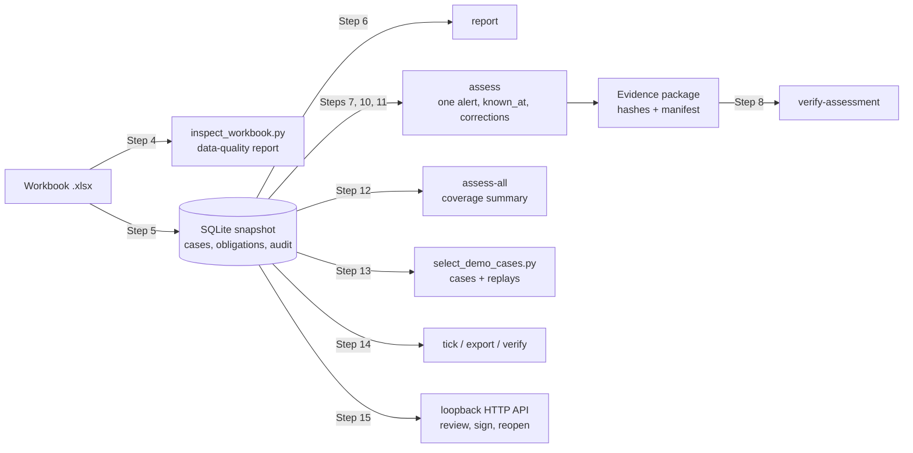

# Step-by-step working

This document walks through the prototype one step at a time, in the order a reviewer would run it, and shows what happens inside at each step. Every output below was captured from a real run on 2026-11-08. Outputs from the **public anonymized workbook** (`data/anonymized-evaluation.xlsx`) are shown verbatim because anyone can reproduce them; outputs from the **supplied pack** are shown as aggregates and identifiers only, because the pack is confidential and is never committed.

Two things to keep in mind throughout:

- The prototype never decides a disposition. Every assessment ends in `ABSTAIN`; what changes between alerts is *why* and *what a human must do next*.
- Two clocks run on one case: the regulatory notification clock (from alert receipt) and the disposition clock (how long review takes). Nothing in the case lifecycle touches the first one.

---

## Part A — Running it

### Step 1. Install

```sh
git clone https://github.com/Zulfiqar7862/kccs-adjudication-case-study.git
cd kccs-adjudication-case-study
python3 -m venv .venv && source .venv/bin/activate
python -m pip install -r requirements.txt
```

What happens: `requirements.txt` installs the `prototype/` package in editable mode. Its only dependency is `defusedxml` (hardened XML parsing for the workbook). No API key, account or network service is needed for anything in this guide.

### Step 2. Prove the environment works (fictional data, no workbook needed)

```sh
python scripts/check.py
```

What happens, in order: (1) the source and tests are byte-compiled; (2) the 54 `unittest` tests run — 20 of them exercise the assessment kernel on small fictional tables, the rest cover the workbook reader, workflow service, CLI and HTTP API; (3) `python -m sentinel demo` starts a real loopback HTTP server on a temporary database, generates a fictional workbook, imports it, and drives one case through its whole life: evidence rejected before it exists → evidence recorded → review → first signature → second signature → `DISPOSED` → reopen → `WAITING_EVIDENCE` again, then verifies the audit chain and exercises a failed-then-retried reminder.

Expected tail of the output:

```
Ran 54 tests in 10.4s
OK (skipped=2)
...
  "audit_integrity": "PASS",
  "prior_revision_preserved": true,
  "reminder_failure_and_retry": "PASS",
  "regulators_not_notified": true
}
All requested checks passed. Private integrations are skipped unless SENTINEL_WORKBOOK is set.
```

The two skipped tests are the ones that need the supplied pack (Step 3).

### Step 3. Run the whole suite against the supplied pack

```sh
export PACK=/absolute/path/to/KCCS_Sentinel_Reference_Data_Pack.xlsx
SENTINEL_WORKBOOK=$PACK python scripts/check.py
```

Observed: `Ran 54 tests … OK` and `All requested checks passed, including the private-workbook integration test.` The pack-specific tests import all 420 events, check that no case is created with a disposition, that tenant case lists do not leak across tenants, that exact-file replay creates nothing, and that the assessment kernel finds the failure modes the pack is known to contain (firmware bulletin, presentation mismatch, SOP overlap, untagged BMS source, alias hints) while hiding the bulletin from a replay dated before it.

If `SENTINEL_WORKBOOK` points at a wrong path the test **fails** rather than skipping; that is deliberate.

### Step 4. Inspect the workbook before trusting it

```sh
python scripts/inspect_workbook.py $PACK --output-dir artifacts/private
```

What happens: every sheet is read with the same hardened reader the prototype uses; cell values stay strings (leading zeros, identifiers and timestamps are never coerced). The script profiles every column (blank / explicit-unknown / timestamp-like / number-like / text), then computes the findings that drive the design: exact tenant-scoped product resolution, identifiers shared across tenants, overlapping SOP revision windows with Excel rows, stability ownership versus file path, readability, firmware builds, timestamp parseability, and which event columns are historical outcomes.

Observed on the pack (aggregates): 15 sheets; 420 events in Excel rows 2–421; product resolution 237 resolved / 141 unresolved / 42 blank; 27 overlapping SOP revision pairs across 10 documents; 3 stability rows filed under another tenant's folder; firmware TT-2.14.3 on 91 events; all 1,260 `*_utc` cells parse, none carries a timezone marker. Full detail: `artifacts/private/workbook-inspection.md` and [data findings](12-data-findings-and-assumptions.md).

### Step 5. Import one snapshot

```sh
python -m sentinel --db prototype/output/private.db import $PACK
```

Output on the public workbook (identical shape on the pack, which creates 420 too):

```json
{
  "import_hash": "1b7c0c937e5ea43e25c100d14670752736afc3a7ea6d191c1a303892396f620d",
  "created": 420,
  "replayed": false
}
```

What happens inside one SQLite transaction: the workbook's SHA-256 is computed; the required sheets and event columns are checked; the whole snapshot is stored with its observation time; for each event a case is created in `WAITING_EVIDENCE` with an import-time blocker analysis, an audit entry is written, and — unless the row says `regulator_reportable = N` — a notification obligation and a reminder outbox row are created from `alert_ts_utc`. If anything fails, nothing is created.

Run the same command again:

```json
{
  "import_hash": "1b7c0c93…",
  "created": 0,
  "replayed": true
}
```

A *different* file into the same database is refused (`Only one workbook snapshot is supported; use a new database for another snapshot`). Silent merging of two snapshots is exactly the "which version did you use?" failure the brief describes, so it is not allowed.

### Step 6. See where every case stands

```sh
python -m sentinel --db prototype/output/private.db report
```

```json
{
  "total_cases": 420,
  "states": { "WAITING_EVIDENCE": 420 },
  "blocker_counts": {
    "Product identifier is missing from the event.": 42,
    "Product master is a historical snapshot without bitemporal validity; …": 420,
    …
```

Every case waits for evidence, because the pack holds indexes, not evidence. That is the intended reading of the pack, not a defect in it.

### Step 7. Assess one alert as a tenant

```sh
python -m sentinel --db prototype/output/private.db assess --tenant T-VIRENT --event EXC-110336 --output artifacts/private/EXC-110336.json
```

On the public workbook the equivalent is `--tenant REF-00010 --event REF-00009`; its assessment (abridged — the full package is `artifacts/public/cases/REF-00009.json`) looks like this:

```json
{
  "event_id": "REF-00009",
  "tenant_code": "REF-00010",
  "time_semantics": {
    "as_at": "2020-02-20T16:00:00+00:00",
    "as_at_basis": "excursion_start_utc (valid time)",
    "known_at": "2026-11-08T18:03:56+00:00",
    "interval_convention": "half-open [from, to); date-only bounds are flagged on the boundary day"
  },
  "inputs": {
    "event_fields_read": 28,
    "historical_fields_excluded": ["case_opened", "triage_outcome", "rules_engine_recommendation", "final_disposition", "reviewer_id", "review_minutes", "systems_opened", "reviewer_overrode", "days_to_disposition", "hours_to_notification", "reported_within_window", "reopened_later", "notes"]
  },
  "entities": [
    { "kind": "PRODUCT", "status": "RESOLVED_EXACT_TENANT_SCOPED" },
    { "kind": "FACILITY", "status": "RESOLVED" },
    { "kind": "FACILITY", "status": "RESOLVED_MULTIPLE_SOURCE_RECORDS" },
    { "kind": "CARRIER_CONTRACT", "status": "UNRESOLVED" }
  ],
  "conflicts": [
    "SOP REF-01734 has overlapping revisions [...] in force at the excursion start."
  ],
  "missing_inputs": [
    "No carrier contract effective at the excursion names 'ref-00016'; claim track cannot start.",
    "Controlled SOP documents themselves are not in the pack; the index is metadata, not procedure evidence.",
    "Stability study REF-01546 is unreadable or only partially readable; a legible controlled copy is required.",
    "Full stability reports are not in the pack; an index row cannot verify findings or applicability.",
    "Raw temperature series is not supplied; only aggregates are available.",
    "No batch identity or lifetime exposure history is supplied; cumulative exposure cannot be computed."
  ],
  "required_human_actions": [
    "Document control must state which revision of REF-01734 governed on 2020-02-20.",
    "A named, authorised human decides the disposition from verified source documents; this assessment is a reviewer aid."
  ],
  "notification": { "status": "NOT_REPORTABLE_PER_RECORD", "clock_starts_at": "2020-02-20T18:00:00+00:00" },
  "conclusion": { "disposition": "ABSTAIN", "readiness": "BLOCKED_BY_CONFLICTS" },
  "manifest": {
    "code_version": "0.2.0", "assessment_version": "assessment-v1", "policy_version": "notification-policy-stub-v1",
    "workbook_sha256": "1b7c0c93…", "python": "3.12.3", "corrections_sha256": "4f53cda1…"
  },
  "assessment_sha256": "5bc086e963583a541f0cfc19220aa1dfb69b975718ed0a4f09f5cafed25a9feb"
}
```

(On the public copy the README tab is redacted, so `extract_date` is null and `known_at` falls back to the import time. On the pack it is the extract date, 2026-09-14.)

How to read it: `entities` says what was identified and how confidently; `evidence.sop / stability / telemetry` (not shown above) list each candidate with its source row and the flags against it; `conflicts` are things that block readiness until a human settles them; `missing_inputs` are things the pack cannot supply; `required_human_actions` is the to-do list; `manifest` pins every version that produced the result; `assessment_sha256` is the content hash of everything above it. Part B explains how each section is produced.

On the supplied pack, EXC-110336 (T-VIRENT) carries three conflicts at once: SOP-VIR-9115 Rev 04 and Rev 05 both in force; the product master pointing at a vial study (STB-4417) for a syringe product; and logger firmware TT-2.14.3 under bulletin TT-CB-114 with the effect recorded as *"may under-report by up to 1.8 °C; the per-device magnitude and direction are not known"* — no correction is applied.

### Step 8. Verify the package

```sh
python -m sentinel --db prototype/output/private.db verify-assessment artifacts/private/EXC-110336.json
```

```json
{ "valid": true }
```

What happens: the assessment body is re-hashed and compared with `assessment_sha256`; each section (`entities`, `evidence`, `conflicts`, `missing_inputs`, `notification`, `manifest`) is re-hashed and compared with `section_sha256`; the package hash is recomputed from those. Edit one character of the file and the command exits 1 with `"valid": false` (this is tested).

### Step 9. Try to read another tenant's alert

```sh
python -m sentinel --db prototype/output/private.db assess --tenant T-AURA --event EXC-110336
```

```
Error: Event 'EXC-110336' is not available to tenant 'T-AURA'
```

Exit code 1. The message is identical for an event that does not exist, so a tenant cannot probe whether another tenant has a given alert. The HTTP API returns the same 404 for the same reason.

### Step 10. Replay with an earlier knowledge cutoff

```sh
python -m sentinel --db prototype/output/private.db assess --tenant T-VIRENT --event EXC-110336 --known-at 2026-01-01T00:00:00+00:00
```

Observed on the pack: the firmware bulletin (recorded 2026-04-11) is reported as `NOT_KNOWN_AT_CUTOFF`; the firmware conflict disappears; the other two conflicts remain; the hash changes:

| `known_at` | Conflicts | `assessment_sha256` |
|---|---|---|
| 2026-01-01 | SOP overlap; presentation mismatch | `1b6163c7…` |
| 2026-04-11 (bulletin date) | SOP overlap; presentation mismatch; firmware under TT-CB-114 | `b287e52e…` |

Neither replaces the other. This is the mechanism that answers the inspector's question "what did you know when you signed?" without pretending the 2026 facts were available in 2025.

### Step 11. Apply a correction and see a *new* assessment, not an edited one

`scripts/select_demo_cases.py` (Step 13) writes `artifacts/private/demo-correction.json`, a correction overlay that replaces the wrong stability reference on EXC-110336's product master row, recorded 2026-09-20:

```sh
python -m sentinel --db prototype/output/private.db assess --tenant T-VIRENT --event EXC-110336 --corrections artifacts/private/demo-correction.json --known-at 2026-09-21T00:00:00+00:00
```

Observed: `inputs.corrections_applied` lists the correction; the presentation-mismatch conflict is gone; the replacement reference is reported as *"not in the stability index … absence is not evidence that no study exists"*; the hash is `74eda239…`. Run the same command with `--known-at 2026-09-14` (before the correction was recorded) and the correction is ignored (`corrections_applied: []`). The original package written in Step 7 still verifies, because it was never touched.

### Step 12. Assess the whole workbook

```sh
python -m sentinel --db prototype/output/private.db assess-all --compare-history --output artifacts/private/assessment-summary.json
```

Observed on the pack (about 2 seconds):

```json
{
  "total": 420,
  "readiness": { "BLOCKED_BY_CONFLICTS": 234, "INCOMPLETE_EVIDENCE": 186 },
  "disposition": { "ABSTAIN": 420 },
  "conflict_kinds": { "Tenant attribution": 96, "Logger firmware": 91, "SOP SOP-VIR-9115": 35, "Product master": 23, "SOP SOP-KAV-5329": 16, "SOP SOP-KAV-9392": 13, "SOP SOP-AUR-6613": 6, "SOP SOP-CAM-7820": 6, "SOP SOP-MER-5228": 4 },
  "product_resolution": { "MISSING_REFERENCE": 42, "RESOLVED_EXACT_TENANT_SCOPED": 237, "UNRESOLVED": 141 },
  "review_candidates": { "count": 118 }
}
```

`--compare-history` is the only place historical outcome columns are read, and only to list cases where a recorded disposition coexists with open evidence conflicts. They are *review candidates*, not errors — the summary says so in its `notice`. The public workbook gives `78 / 342` and 46 candidates, because firmware, readability, tenant constraints and incidents are redacted there.

### Step 13. Pick the demonstration cases by program, not by hand

```sh
python scripts/select_demo_cases.py --db prototype/output/private.db --output-dir artifacts/private
```

What happens: every event is assessed; for each failure mode the *first* matching event in workbook order is chosen; its package is written to `artifacts/private/cases/`; the knowledge-cutoff replay (Step 10) and the correction replay (Step 11) are run and their hashes recorded in `demo-cases.json`. Observed on the pack: 10 of 11 modes found (blank product reference EXC-112198; firmware bulletin, SOP overlap and presentation mismatch all on EXC-110336; untagged BMS source EXC-111008; unreadable study EXC-112583; unverified alias hint EXC-111064; recorded notification window EXC-110287; study absent from index EXC-111519; boundary day EXC-110098). Carrier parent/subsidiary ambiguity does not occur in the pack and is covered by a fictional unit test only.

### Step 14. The reminder stub, export and audit verification

```sh
python -m sentinel --db prototype/output/private.db tick --tenant T-AURA
python -m sentinel --db prototype/output/private.db tick --tenant T-AURA --fail
python -m sentinel --db prototype/output/private.db export --tenant T-AURA --case EXC-112198 --output artifacts/private/EXC-112198-audit.json
python -m sentinel --db prototype/output/private.db verify artifacts/private/EXC-112198-audit.json
```

`tick` delivers internal reminders for open obligations and always reports `"regulators_not_notified": true`; with `--fail` the injected transport outage is recorded on the outbox row and the reminder stays pending (nothing is marked delivered). `export` writes the hash-chained case history (every revision, review, signature and audit entry); `verify` recomputes the chain. An unknown tenant on `tick` is an error, not an empty success.

### Step 15. The HTTP lifecycle (fictional data)

```sh
python -m sentinel sample
python -m sentinel import prototype/output/sample.xlsx
python -m sentinel credentials --tenant DEMO-ALPHA --tenant DEMO-BETA
python -m sentinel serve            # http://127.0.0.1:8080, loopback only
python scripts/api_example.py       # in another shell: lists DEMO-ALPHA's cases with a bearer token
```

Routes, bodies, `expected_version` and `Idempotency-Key` semantics are in [API.md](API.md). An unauthenticated request gets 401; a stale `expected_version` gets 409; a signature by the same actor who reviewed is refused; a tenant whose policy says "dual" needs two independent signatures before `DISPOSED`.

---

## Part B — What the kernel does with one alert

`assess(tables, event_id, principal_tenant, known_at, corrections)` in `prototype/src/sentinel/evidence/assessment.py` runs these steps in order. Each step only reads the fields in `ALLOWED_EVENT_FIELDS`; the thirteen historical columns are listed and never read.

| # | Step | Reads | Produces | Fails closed when |
|---|---|---|---|---|
| 1 | **Authorise** | event's `tenant_code` vs the principal | — | tenant differs or event missing → `AccessDenied`, same message for both |
| 2 | **Fix the two clocks** | `excursion_start_utc` → `as_at`; README extract date → default `known_at` | `time_semantics` | start time unparseable → SOP selection is skipped and reported |
| 3 | **Overlay corrections** | each correction's `recorded_at` vs `known_at` | `inputs.corrections_applied` (tables are copied, never mutated) | a correction targets an unknown row → error |
| 4 | **Resolve product** | `product_ref_as_received` against `brand_as_labelled`, `internal_sku`, `gtin`, `legacy_code` **within the tenant only** | `PRODUCT` entity: `RESOLVED_EXACT_TENANT_SCOPED` / `AMBIGUOUS` / `UNRESOLVED` / `MISSING_REFERENCE` | more than one match → conflict; no match → alias observations confirmed on or before `known_at` are listed as *unverified candidates* and a human action is added |
| 5 | **Resolve facilities** | `origin_ref_as_received`, `dest_ref_as_received` against code, record id and name across the three source systems | `FACILITY` entities with every source record, flagged `timezone_trust: UNTRUSTED` | conflicting timezones across records → `CONFLICTING_SOURCE_RECORDS` + conflict |
| 6 | **Resolve carrier contract** | `carrier_ref_as_received` against legal entity, `names_seen_on_documents`, `parent_of`; contract effective at `as_at` ("evergreen" = open-ended) | `CARRIER_CONTRACT` entity with claim window and liability cap, plus the note that claims never gate the disposition | names match two legal entities → `AMBIGUOUS_PARENT_OR_SUBSIDIARY` |
| 7 | **Select SOPs as at** | same-tenant `05_SOP_Index` rows with `effective_from <= as_at < effective_to` (half-open) | `evidence.sop.candidates` with flags (site-specific annexure, scanned, date-only boundary) | two revisions of one `doc_id` both in force → conflict + document-control action; a revision ending **on** the excursion date → listed in `rejected` with a conflict, not silently dropped |
| 8 | **Check stability** | the product's `stability_study_ref` against same-tenant `06_Stability_Index` rows; ownership from `tenant_code`, not the file path | `evidence.stability.candidates` with `usable` and flags | reference only under another tenant → rejected; absent → *"absence is not evidence that no study exists"*; presentation after the em dash ≠ product presentation → conflict; `readable` ≠ Y or no permitted-excursion statement → unusable |
| 9 | **Check telemetry** | `logger_fw`, `gateway_gap_min`, `interpolated`, `readings_in_window`, `source_system`; `14_Incident_Log` rows mentioning a bulletin and the build | `evidence.telemetry` with bulletins and flags | build under a bulletin recorded on or before `known_at` → conflict with the bulletin's *stated bound* and no correction; recorded after → `NOT_KNOWN_AT_CUTOFF`; `source_system = SYS-03` (BMS, untagged) → *quarantine for attribution* conflict |
| 10 | **Create the obligation view** | `alert_ts_utc`, `regulator_reportable`, `reg_window_hours`, tenant signatory and language | `notification` with `clock_starts_at`, provisional `due_at`, `status` | no window on the row → `URGENT_POLICY_REVIEW`, never "not required" |
| 11 | **Conclude** | the lists above | `conclusion.disposition = ABSTAIN`; `readiness` = `BLOCKED_BY_CONFLICTS` if any conflict, else `INCOMPLETE_EVIDENCE` if anything is missing, else `EVIDENCE_ASSEMBLED` | — |
| 12 | **Pin and hash** | code, assessment, policy versions; workbook SHA-256; corrections hash | `manifest`, `assessment_sha256` | — |

`package()` wraps the result with per-section hashes and a package hash; `verify_package()` recomputes all of them.

---

## Part C — How the pieces fit



What is real and what is stubbed in this picture: the workbook reader, snapshot store, assessment kernel, packages, hashes, case workflow, audit chain and HTTP API are implemented. The notification *policy* (window from the row), the reminder *transport*, receipts (human-attested) and credentials (local bearer tokens) are stubs, labelled as such in their output. Regulator filing, document retrieval, OCR, calendars, a language model and regional deployment are design-only ([LLD](13-detailed-design-lld.md)).

---

## Part D — Reproducing this page

```sh
# public copy, committed under artifacts/public/
python -m sentinel --db prototype/output/evaluation.db import data/anonymized-evaluation.xlsx
python scripts/inspect_workbook.py data/anonymized-evaluation.xlsx --output-dir artifacts/public
python scripts/select_demo_cases.py --db prototype/output/evaluation.db --output-dir artifacts/public
python -m sentinel --db prototype/output/evaluation.db assess-all --compare-history --output artifacts/public/assessment-summary.json

# supplied pack, local only (artifacts/private/ is ignored by git)
python -m sentinel --db prototype/output/private.db import $PACK
python scripts/inspect_workbook.py $PACK --output-dir artifacts/private
python scripts/select_demo_cases.py --db prototype/output/private.db --output-dir artifacts/private
python -m sentinel --db prototype/output/private.db assess-all --compare-history --output artifacts/private/assessment-summary.json
```

Same snapshot + same `known_at` + same corrections ⇒ same `assessment_sha256`. That property is what the [operations runbook](15-operations-runbook.md) uses to detect silent drift six months from now.
