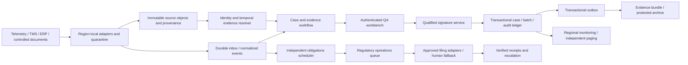

# Production HLD / LLD and qualification plan

**Design proposal, not implemented functionality.** `ARCHITECTURE.md` is the exact local-code contract. This document specifies the wider system the six-person team would build behind the gated rollout. Policy values below are proposed engineering defaults unless identified as workbook facts; QA/legal must approve regulatory semantics.

## 1. Deployment and component boundaries

Deploy a regional cell for each authorized residency boundary, initially an EU pilot cell. Keep tenant keys, queues, blobs, indexes, backups, logs and processing inside the required region. A shared control plane may distribute code/package hashes and non-sensitive health totals only, never evidence, embeddings, prompts or case identifiers. The tenant requiring exclusive derived artifacts gets a tenant-exclusive data/derived-artifact boundary. India-only and EU-only are enforced by egress/network/storage policy, not a request flag.



Start with a modular service and separately deployed ingestion and deadline workers, not a microservice per table. A relational transaction covers case version, approval event, batch reservation and outbox intent; distribute only at real trust, scaling or fault boundaries. The deadline worker has its own connection pool, reserved workers and queue so evidence extraction, a model outage or alert storms cannot starve notification work. Source object storage is separate because retention and large immutable bytes differ from transactional queries. Signature and filing integrations remain separately qualified authorities.

## 2. Source adapters, identity and ordering

Tab `11_Systems_Inventory` defines the initial adapter contracts:

| Source | Integration and required behavior |
|---|---|
| Telemetry provider A SYS-01 | REST poll below the 300 req/min hard limit; tenant/cursor checkpoints, overlapping fetch window and dedupe; up to four hours of reconnect backfill. Persist source bytes before acknowledging ingestion. |
| Gateway provider B SYS-02 | MQTT at-least-once push; dedupe by source event ID, retain out-of-order samples up to the documented 90 minutes and accept later corrections as new evidence, not overwritten samples. |
| Building monitoring SYS-03 | OPC-UA → Kafka; gaps have no backfill. Persist gap evidence. Missing tenant tags go to a restricted quarantine with human assignment; never route by a fuzzy facility-name guess. |
| Transport management SYS-04 | Debezium CDC; transaction/order cursor, shipment/leg associations and correction events. |
| Tenant ERP SYS-05 | SFTP batches with per-file digest, manifest and atomic publication; late files occur 3–6 times/month. Keep event-time and receipt-time distinct. |
| Stability SYS-06 | No API in the inventory. Controlled, tenant-approved document export with manifest and QA ownership attestation; no invented SharePoint API access. OCR is an extraction proposal, not evidence approval. |
| SOP SYS-07 | Controlled document library REST below 60 req/min; fetch exact revision and annexes, not just latest; retain original and rendition with hashes. |
| Contracts SYS-08 | Controlled Box/shared-drive export plus legal-entity, amendment and temporal review; names of a parent/subsidiary cannot substitute for contractual counterparty. |
| Carrier SYS-09 | Source-specific REST/EDI adapters and controlled CSV/email/fax manual intake; preserve sender, attachment and translation provenance. Unsupported formats create human work, not a silent success. |

Canonical envelope: `tenant_id, source_system, source_event_id, source_revision, event_time_utc, observed_at_utc, ingested_at_utc, schema_version, source_uri, source_sha256, correlation_id, payload`. Unique inbox key is `(tenant, source, event_id, source_revision)`; a same-key/different-hash conflict is quarantined. Store cursor and inbox commit atomically. Producer retry is normal. Never use hash equality of temperature/duration alone to conclude that two physical excursions are duplicates.

Maintain governed `entity_alias(tenant, entity_kind, alias, canonical_id, valid interval, recorded interval, confirmer, evidence_id)`. Exact alias resolution can return zero, one or many candidates. Zero/many require review. Facility identity, site timezone, product presentation and carrier legal entity are distinct domains; do not collapse them into a global name map. The ad hoc alias workbook is a source of proposals, not authority. Route incidents to parent groups for operational triage, but retain each child's case, product context and regulatory obligation.

## 3. Data model and time

All operational primary/foreign keys begin with `tenant_id`; database row security is defense in depth, not the only authorization check. Use PostgreSQL for the regional production ledger. Large original bytes live in tenant-keyed immutable object storage; `artifact` stores digest, media type, source version, ownership, received time, malware-scan status and retention policy. Store sensitive content outside ordinary application logs.

| Entity | Important fields and constraints |
|---|---|
| `source_event` / `inbox` | Envelope above; original object hash; immutable revisions; dedupe constraint and processing status. |
| `case` | ID, source event(s), active revision, optimistic version, operational state, assigned queue; no global unscoped identifier lookup. |
| `case_revision` | Reason/opened time; immutable signed snapshot once disposed; inherited references are candidates until revalidated. |
| `evidence_fact` | Subject, fact type, structured value/unit, source artifact/page/region, valid-from/to, recorded-from/to, extractor version, QA verification and uncertainty. |
| `policy_bundle` | Tenant/site/product/jurisdiction scope, version, effective dates, approval roster, clock/calendar rule, source document IDs, signed release manifest. |
| `review` / `signature` | Exact packet digest, actor/authority version, role, intent, timestamp, authentication ceremony result; multiple signatures must bind the same packet and disposition. |
| `batch_exposure` | Batch/presentation/affected quantity, temperature interval and duration, source IDs, uncertainty bounds, correction link; no summing an overlapping duplicate twice. |
| `obligation` | Case/event, jurisdiction/program, policy version, start basis/time, due time, status, responsible person; independent from case state. |
| `notification_attempt` / `receipt` | Obligation ID, stable delivery key, attempt state/time, recipient/channel, payload hash, remote ID/acknowledgement, verification authority. |
| `audit_event` | Tenant/case revision, actor, action, old/new packet references, previous hash, current hash, external checkpoint. |
| `outbox` / `job` | Stable effect key, next attempt, retry count, lease/timeout, error category, durable result; transactional enqueue. |

Bitemporal records use half-open intervals. Example: select the SOP applicable **at excursion time**, as known **at review time**:

```sql
SELECT * FROM evidence_fact
WHERE tenant_id = :tenant AND subject_id = :site_product
  AND fact_type = 'SOP_APPLICABILITY'
  AND valid_from <= :excursion_time
  AND (valid_to IS NULL OR :excursion_time < valid_to)
  AND recorded_from <= :review_cutoff
  AND (recorded_to IS NULL OR :review_cutoff < recorded_to);
```

Return every candidate; overlapping valid records are a QA exception, not “latest wins”. Confirm end-date semantics with document control before converting inclusive dates. The local prototype's `known_at` filter only expresses the workbook's snapshot date; it is not this full model. Store named timezone/calendar versions and UTC instants for legal clocks; reviewer local offsets must not be inferred from the two known-wrong facility timezone fields.

Notification uses **alert/detection time** as specified by the pack, not excursion start or disposition time. Production computes fixed-hour, calendar-day, or next-business-day deadlines from an approved program policy and versioned holiday/timezone calendar. Reportability unknown creates urgent manual policy work and conservative escalation, never “not required”. Reopening cannot restart an existing obligation; a genuinely new reportable event creates a separately linked obligation only after policy review.

Batch exposure cannot be computed faithfully from this workbook: batch/quantity identities and full samples are missing. Production records interval unions per exposure domain, concurrent shipment splits and uncertainty rather than blindly summing alert durations. Reserve/update exposure under a batch-level transaction/version when signing; conflicting simultaneous reviews retry with current exposure. A calibration correction references prior samples, triggers dependency lookup, flags affected cases and opens new revisions; it does not apply a uniform +1.8°C correction or delete earlier evidence.

## 4. Workflow, waiting and delayed corrections

Operational states: `RECEIVED → TRIAGE → WAITING_IDENTITY / WAITING_EVIDENCE / WAITING_EXTERNAL → READY_FOR_REVIEW → AWAITING_SIGNATURE → DISPOSED`. Manual quarantine/rework/return outcomes are dispositions with follow-up tasks, not permission to drop notification monitoring. Approved deterministic duplicate/non-event closure is a separate `CLOSED_NON_ACTIONABLE` route and is **not implemented in the prototype**; every closure requires a qualified rule version, proof and an audited false-closure evaluation.

Each waiting task has owner, reason, required source, evidence freshness condition, next check and escalation deadline. Proposed default: reassess pending obligations every minute and page at 50%, 75%, and 90% of the legal window, plus overdue; QA may require earlier thresholds. These reminders are separate from regulatory filing. Timer jobs survive restart. Dependency callbacks are deduplicated, re-evaluate only affected cases and never clear blockers solely because a connector returned HTTP 200. Manual completion needs source references and authority.

Review captures every blocker resolution and a structured argument: applicable rule, observed fact, evidence citation, uncertainty, disposition and rationale. New evidence/policy changes invalidate pending approvals. Signatures bind the frozen packet hash. A stale case/batch version returns conflict; there is no last-writer-wins release.

Months later, a bulletin or new source creates an impact-review event through the artifact/product/logger dependency index. Retain original decision, original policy and “known then” facts; open a new revision and re-check current authority and evidence. Notify QA and affected claims/invoices through outbox commands with compensating business actions (e.g. withdraw an invoice), not database reversal. Keep exports of both revisions. Claims deadlines and regulatory follow-up obligations require legal review and independent tracking.

## 5. Failure modes and regulatory consequences

| Failure | Behavior and recovery | Clock effect |
|---|---|---|
| Source/document/OCR unavailable | Keep last artifact with freshness warning; block unsupported readiness; circuit-break adapter; retry with jitter and per-source quota; controlled manual upload. | None: obligations and human filing route continue. |
| Model/provider unavailable or unqualified replacement | Omit optional narrative/retrieval augmentation; present structured evidence; never silently switch to an unqualified provider. | None; no model dependency in deadline path. |
| Telemetry late, duplicate, permanently missing | Preserve actual series and lineage; dedupe source identity; late evidence triggers reevaluation; gaps remain explicit. | Detection clock is not retroactively shifted by reordering. |
| Queue/worker outage or alert storm | Durable inbox/outbox; reserved regulatory workers; per-tenant fairness, incident grouping, backpressure; backlog-age and deadline-priority monitoring; replay after recovery. | Deadline still elapses; on-call uses manual registry/filing if capacity is at risk. |
| Relational store unavailable | Reject mutations, do not acknowledge commits or issue unlogged signatures; durable source retention; audited manual emergency procedure and later reconciliation. | External duty continues. Secondary monitoring and regulatory owners cannot depend solely on the failed database. |
| Filing transport failure/timeout | Record attempt; retry same stable key; query remote status when outcome is unknown; require receiver dedupe or human reconciliation before resend. A request accepted by an API is not necessarily a legal receipt. | Clock continues until qualifying receipt; page humans early. |
| Region unavailable | Fail over only to an approved same-residency recovery site; otherwise stop data movement and invoke regional manual continuity. | No automatic waiver or clock pause; notify compliance leadership. |
| Audit object corrupt/missing | Fail export verification, page integrity incident, restore verified backup; do not fabricate historical records. | Independent filing duties remain; document control assesses audit impact. |

Proposed targets to agree with operations: audit bundle retrieval within one hour; durable committed case records RPO 0 within the regional replication design, and tested region-recovery RPO/RTO (e.g. ≤15 minutes/≤60 minutes) only if budget and legal policy support it. These are targets, not benchmarked guarantees. Seven years of retained evidence is mandatory; QA/legal must define start event, legal holds, deletion and key-retention policy. Archive original bytes, parsed facts, rendered signed packet, policy/code/model versions and qualified signature evidence. Test restoration and export regularly; hashes alone are insufficient.

## 6. Qualification, deployment and rollback

Version code, schema, adapter mapping, governed aliases, approved rule/policy/calendar bundles, OCR/parser, optional retrieval index, embedding/model/provider and prompt independently. A case pins the complete release manifest. Do not let “latest” modify signed history or active adjudication without an explicit reevaluation event.

Pipeline: review → secret/dependency/static checks → unit/API/tenant-isolation/concurrency tests → all-workbook structural replay → QA-curated retrospective clinical benchmark with independently verified evidence → migration/backup/restore and disaster/alert-storm rehearsal → QA/security approval → shadow deployment for one tenant/site → controlled canary → signed tenant promotion. The production cohort must include language, handwritten-annex, wrong-presentation, missing-source, dual-signature, storm, late-data and correction cases. Freeze acceptance thresholds and false-closure cost before evaluating. The public and opt-in private tests are the first stage, not a substitute for qualification.

Use expand/backfill/contract database migrations with compatible readers; record schema versions and validate backfill counts/hashes. Stop promotion on evidence drift, tenant leakage, unknown deadline, increased false-safe closures or budget violations. Roll back code/config to a qualified manifest; never erase audit/case events. If a new version already generated decisions, identify affected packets and open controlled review rather than pretending rollback undid their legal consequences.

Optional AI comes later and may draft only cited summaries, never invent a missing stability limit or bypass a signer. Enforce tenant provider/residency permission before retrieval or inference, tenant-exclusive derived indexes where required, source-level citations, structured output validation and adversarial document-instruction tests. Budget each tenant/case before calls, cache only authorized artifacts, track quiet-period cost, and reject unqualified fallback. Vendor deprecation notice starts a qualification plan; expired qualification disables that feature while the non-model workflow continues.
