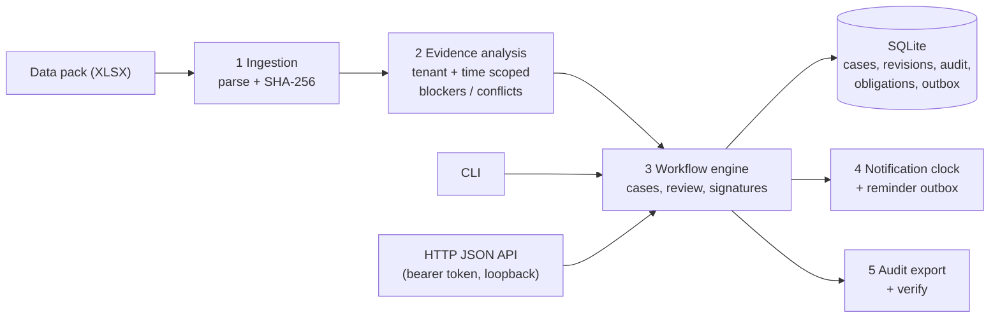
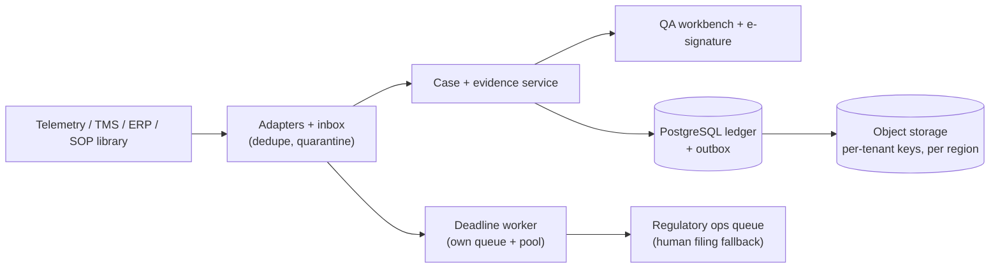

# HLD: the 5-minute version

> One sentence: **Sentinel turns a temperature-excursion alert into a tamper-evident evidence file, so a named human can sign a disposition, while the 72-hour regulator clock runs on its own.**

## 1. The problem in plain words (from the brief)

- 11,400 alerts/month; about 2,000 are real, and each needs a **human-signed** decision (release, quarantine, destroy, and so on).
- The decision is rarely hard. **Collecting the evidence is the cost.** In EXC-107133, 10 minutes went on the answer and 100 minutes on proving the right to sign it: product IDs that don't match, overlapping SOP revisions, the carrier contract and the lane history.
- Two different clocks: **regulator notification (72 h)** and **disposition (median 6.2 days)**. Missing the first is a failure on its own.
- Past incidents (tab 14) show what goes wrong: an AI prompt edit changed outcomes for 31 tenants, data leaked across tenants, and nobody could reconstruct why a decision was made.

## 2. What I decided to build (and not build)

| Build | Don't build (and why) |
|---|---|
| Evidence assembly: find the right SOP, stability study, product and carrier **as at the excursion time**, scoped to one tenant | An auto-decider or LLM recommender. Incident history shows it is risky, and the decision is not the bottleneck |
| **Abstain** when evidence is missing or conflicting, and name the conflict | Fuzzy matching ("Tapti Exp" ≈ "Tapti Express"), because a wrong match is worse than "unresolved" |
| Case workflow: evidence, review, independent signatures, reopen | Microservices, Kafka, Kubernetes: unnecessary at about 2,000 cases/month |
| Separate notification clock, plus a hash-chained audit trail | Real regulator filing, OCR, SSO (stubs and next phases) |

## 3. Architecture (what runs today)

Five boxes, and each one has a single job:

1. **Ingestion** (`ingestion/workbook.py`): reads the XLSX safely (`defusedxml`), keeps source row numbers and hashes the file. The same file twice is a no-op; a different file is rejected.
2. **Evidence analysis/assessment** (`evidence/analysis.py`, `evidence/assessment.py`): for one alert, returns *candidates*, *conflicts* and *missing inputs*. The verdict is always `ABSTAIN` plus a readiness value (`BLOCKED_BY_CONFLICTS`, `INCOMPLETE_EVIDENCE` or `EVIDENCE_ASSEMBLED`).
3. **Workflow engine** (`workflow/service.py`): the single place where state changes happen, inside one DB transaction together with the audit record.
4. **Notification clock**: an obligation is created **at import**, independent of case state, so a waiting case cannot pause the legal deadline.
5. **Audit export**: each case's audit log is a hash chain (each entry hashes the previous one), so any edit is detectable.

## 4. Production picture (proposed, not built)

What changes from prototype to production: SQLite becomes PostgreSQL, the XLSX snapshot becomes live adapters, the reminder stub becomes a dedicated deadline worker, and there is one **regional cell** per residency boundary (EU, India). It stays a **modular monolith**: case state, audit and outbox must commit in one transaction.

## 5. Key design choices (each is a one-line answer in the interview)

| Question | Answer |
|---|---|
| Why abstain instead of recommend? | The brief's cost is evidence, not judgement. A wrong confident answer causes the incidents in tab 14 |
| Why is the clock separate from the case? | The 72 h duty starts at the alert. It must not pause while the case waits for a CSV from a carrier |
| How do you stop tenant leaks? | Every query takes `tenant`. Another tenant's case returns **404**, the same as a missing case |
| How do you reproduce an old decision? | Assessments pin the workbook hash, code version and `known_at` cutoff, and the output is hashed. Same inputs give the same hash |
| What about concurrency or double clicks? | `expected_version` (optimistic lock) plus an `Idempotency-Key` on every write |
| What is the failure mode for reminders? | Outbox with at-least-once delivery and a stable dedupe key. Delivery failure means retry; it never means "filed" |

## 6. How you would detect failure in production

- **Clock health:** count of obligations `OVERDUE` or `DUE_SOON` with no receipt, paged at 50/75/90% of the window.
- **Outbox lag:** rows with `delivered_at IS NULL` and their oldest age.
- **Audit integrity:** a nightly `verify` of exports, alerting on any chain break.
- **Abstain mix per tenant:** a sudden change after a deploy means a regression (the November prompt-change incident).

Next level of detail: [LLD.md](LLD.md). Running it: [DEMO.md](DEMO.md).
