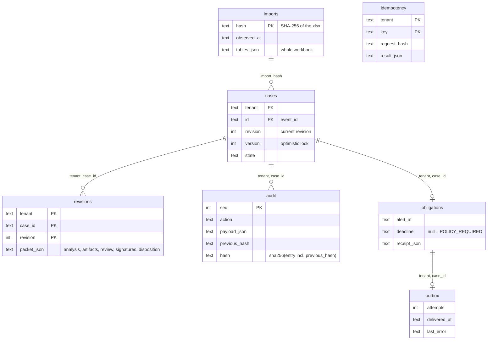
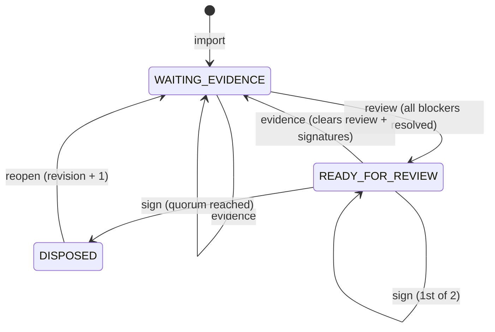

# LLD: how the code actually works

Read [HLD.md](HLD.md) first. Every section here points at the file and function that implements it, so you can open the code during the interview.

## 1. Code map (about 1,300 lines of Python, standard library plus `defusedxml`)

```
prototype/src/sentinel/
├── ingestion/workbook.py    load(path) -> {sheet: [row dicts with _row]},  sha256(path)
├── evidence/analysis.py     analyze(tables, event) -> {candidates, blockers}   (used at import)
├── evidence/assessment.py   assess(tables, event_id, principal_tenant, known_at, corrections)
│                            package(assessment) / verify_package(bundle)
├── workflow/service.py      Engine: ingest, command, notifications, tick, export; verify_export()
├── api/http.py              make_server(engine, credentials): routes -> Engine
├── cli.py                   python -m sentinel <command>
└── demo.py                  run_demo(): real HTTP walkthrough on fictional data
```

Layering rule: **API and CLI are thin adapters, and only `Engine` changes state.** Evidence code is pure: tables in, a dict out, no database and no clock.

## 2. Data model (SQLite, created in `Engine.__init__`)



Points to call out:
- **Every primary key starts with `tenant`.** There is no way to query a case without naming the tenant.
- `cases` holds the *current pointer*. `revisions` holds history: reopening inserts a new revision and never overwrites the signed one.
- `version` changes on every write (optimistic lock). `revision` changes only on reopen.

## 3. Case state machine (`Engine.command`)



| Command | Allowed role | Preconditions (otherwise error) | Effect |
|---|---|---|---|
| `evidence` | reviewer | not `DISPOSED` (409); kind in SOP/STABILITY/TELEMETRY/IDENTITY/BATCH/CONTRACT/OTHER | appends artifact `E<n>` with SHA-256 of its content; **clears review and signatures** |
| `review` | reviewer | every analysis blocker mapped to existing evidence IDs; all 6 required kinds present (422) | state `READY_FOR_REVIEW` |
| `sign` | `signer`, or `site_qa` + `corporate_qa` for "dual" tenants | state `READY_FOR_REVIEW` (409); signer ≠ reviewer (403); no duplicate actor/role; same disposition as earlier signer (409) | signature binds `evidence_hash`; when all required roles have signed, state becomes `DISPOSED` |
| `reopen` | reviewer | state `DISPOSED` (409) | new revision with empty artifacts; old revision untouched |
| `notify` | regulatory | an obligation exists; there is no earlier receipt; `alert_at ≤ sent_at ≤ now` | stores a human-attested receipt (never auto-generated) |

## 4. One write, step by step (`Engine.command`, `workflow/service.py`)

```mermaid
sequenceDiagram
    participant C as Client
    participant H as api/http.py
    participant E as Engine.command
    participant DB as SQLite
    C->>H: POST /cases/{id}/sign  (Bearer, Idempotency-Key, expected_version)
    H->>H: token -> principal {tenant, actor, role}; JSON / size checks
    H->>E: command(principal, id, 'sign', body, key, version)
    E->>DB: BEGIN IMMEDIATE (one writer)
    E->>DB: key seen? same request -> return stored result; different -> 409
    E->>DB: load case WHERE tenant=? AND id=?  (missing -> 404)
    E->>E: version == expected? (else 409) -> role + business rules
    E->>DB: UPDATE revisions, UPDATE cases (version+1, state)
    E->>DB: INSERT audit (hash chained to previous entry)
    E->>DB: INSERT idempotency(key, request_hash, result)
    E->>DB: COMMIT  (all or nothing)
    E-->>H: {id, revision, version, state}
    H-->>C: 200 JSON  (DomainError -> 4xx JSON)
```

Why this matters: state, audit and idempotency are written in **one transaction**. A crash cannot leave a state change without its audit record.

## 5. Evidence assessment (`evidence/assessment.py::assess`)

Input: the workbook tables, `event_id`, `principal_tenant`, `known_at` (optional) and `corrections` (optional). Output: a dict, hashed with SHA-256.

1. **Tenant gate:** if the event is missing *or* belongs to another tenant, raise `AccessDenied` with the same message for both, so the caller cannot tell whether the event exists.
2. **Time:** `as_at` = excursion start (when it happened). `known_at` = what we knew (defaults to the pack extract date). Corrections recorded after `known_at` are ignored.
3. **Resolvers**, each writing into `entities`, `evidence`, `conflicts` and `missing_inputs`:
   - `_resolve_product`: exact, tenant-scoped ID match (GTIN, SKU or alias). Zero or many matches means *unresolved*, never a guess.
   - `_resolve_facility`, `_resolve_carrier`: exact match. Contracts are checked against the excursion date.
   - `_sop_evidence`: SOP revisions in force at `as_at`. **Overlapping revisions are a conflict.** A missing site annex is a missing input.
   - `_stability_evidence`: the study must match the product *presentation* (pen vs vial). Unreadable scans are rejected with a reason.
   - `_telemetry_evidence`: gateway gaps, interpolated readings and the firmware bulletin (`TT-CB-114`) become conflicts.
   - `_notification`: the regulator window starts at the alert, not at review.
4. **Conclusion:** always `disposition: ABSTAIN`. `readiness` is `BLOCKED_BY_CONFLICTS` if there are conflicts, else `INCOMPLETE_EVIDENCE` if inputs are missing, else `EVIDENCE_ASSEMBLED`.
5. **Manifest:** code version, policy version, workbook SHA-256 and corrections hash. `assessment_sha256 = sha256(canonical JSON)`.
6. `package()` hashes each section. `verify_package()` recomputes the hashes, so any edit makes it fail.

Same inputs always give the same hash (determinism test). A different `known_at` gives a different hash (reproducibility of "what did we know then").

## 6. Notification clock (`Engine.ingest`, `Engine.notifications`, `Engine.tick`)

- At **import**, in the same transaction: if `regulator_reportable != 'N'`, insert an obligation with `deadline = alert_ts + reg_window_hours` and an outbox row. A bad or missing window gives `deadline = NULL`.
- Status is computed when read, never stored:

| Condition | Status |
|---|---|
| `deadline` is NULL | `POLICY_REQUIRED` (unknown policy is **not** "not reportable") |
| receipt `sent_at ≤ deadline` | `NOTIFIED_ON_TIME` (otherwise `NOTIFIED_LATE`) |
| no receipt and `now > deadline` | `OVERDUE` |
| no receipt and within 24 h | `DUE_SOON` (otherwise `OPEN`) |

- `tick(tenant, transport)`: reads undelivered outbox rows, calls the transport **outside** the DB lock with a stable key `tenant:case:notification-required`, then records success or failure. On failure, `delivered_at` stays NULL and the next tick retries (at-least-once delivery; consumers dedupe on the key).
- Case state never touches this table, so reopening or waiting cannot pause the clock.

## 7. Audit hash chain (`Engine._audit`, `export`, `verify_export`)

```
entry_n.hash = sha256(canonical{tenant, case_id, revision, at, actor, action, payload, previous_hash = entry_(n-1).hash})
manifest_hash = sha256(whole export without manifest_hash)
```
`verify_export` re-walks the chain, recomputes each artifact's content hash and checks the manifest. This gives tamper *evidence*, not WORM storage. Production would anchor the chain head externally.

## 8. API contract (`api/http.py`)

| Method and path | Purpose |
|---|---|
| `GET /health` | no authentication required |
| `GET /cases` | list the caller's tenant's cases |
| `GET /cases/{id}` | case and packet (404 if the case belongs to another tenant) |
| `GET /cases/{id}/audit` | export bundle |
| `GET /notifications` | obligations with computed status |
| `GET /sops?valid_at=&known_at=` | SOP revisions as at a time |
| `POST /cases/{id}/{evidence or review or sign or reopen or notify}` | body JSON includes `expected_version`; `Idempotency-Key` header is required |

Errors: 400 bad input, 401 no or bad token, 403 role, 404 not found or other tenant, 409 state/version/idempotency conflict, 413 body over 256 KB, 415 not JSON, 422 business rule.
Hardening: binds to loopback only, tokens of at least 16 characters, request bodies are size-limited, no request logging (to avoid leaking tokens).

## 9. Failure handling summary

| Failure | Behaviour |
|---|---|
| Same workbook imported twice | `replayed: true`, nothing changes |
| Different workbook into the same DB | 409; use a new DB (reconciliation is out of scope) |
| Two users edit the same case | the second gets 409 "stale version; reload" |
| Client retries a POST | same `Idempotency-Key` and body returns the first result; a different body gets 409 |
| Crash mid-command | transaction rolls back; no partial state, no orphan audit |
| Reminder transport down | failure recorded, retried on the next tick, never shown as "filed" |
| Missing or conflicting evidence | `ABSTAIN` plus a named conflict for a human to resolve |

## 10. Tests that prove each rule (`prototype/tests`)

| Rule | Test |
|---|---|
| Cross-tenant answers 404 | `unit/test_assessment.py::test_same_identifier_under_two_tenants_resolves_only_within_tenant`, `integration/test_http.py::test_health_auth_tenant_scope_and_headers` |
| Overlapping SOPs are a conflict | `test_overlapping_sop_revisions_are_a_conflict` |
| Wrong presentation is not a match | `test_wrong_presentation_is_a_conflict_not_a_match` |
| Deterministic hash | `test_repeated_execution_is_deterministic` |
| Tamper detection | `test_package_verification_detects_tampering` |
| Only one concurrent writer wins | `integration/test_workflow.py::test_concurrent_commands_allow_only_one_version_winner` |
| Failed command leaves no trace | `test_invalid_command_rolls_back_packet_and_audit` |
| Dual signature, reopen, audit chain | `test_dual_review_sign_reopen_and_audit_integrity` |
| Clock unaffected by case state | `test_regulatory_clock_is_unchanged_by_review_signature_and_reopen` |
| Reminder retry never fakes a receipt | `test_reminder_retry_never_creates_receipt_and_deadline_is_data_derived` |
| Real data pack (opt-in) | `integration/test_private_workbook.py` (set `SENTINEL_WORKBOOK`) |
